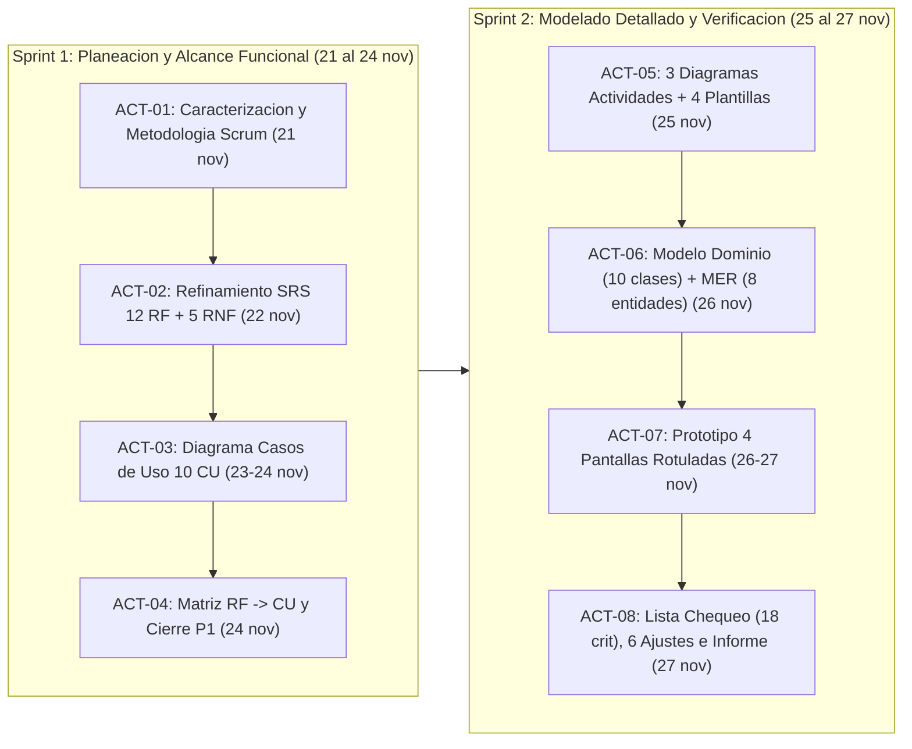

# 03 · Plan de Actividades de Análisis, Cronograma y Entregables

**Proyecto:** Sistema de Control de Asistencia Académica con QR Dinámico (`asistencia-qr`)  
**Metodología seleccionada:** Scrum (Fase de Análisis organizada en 2 Sprints con *Product Backlog* priorizado por MoSCoW y *Definition of Done* verificable)  
**Autor (GitHub):** `@estiben08`  
**RAP asociado:** 592375 · Establece las actividades de análisis de acuerdo con la metodología seleccionada (Criterio C2).

---

## 1. Estructura de Sprints de Análisis (Coherencia con Scrum)

En coherencia con **Scrum**, el trabajo de análisis no se ejecuta como una cascada ciega con una única entrega tardía, sino en **dos iteraciones (Sprints) con entregables incrementales e inspección intermedia**:

- **Sprint 1 de Análisis (Estructuración del Backlog y Modelado Funcional — Días 1 a 4):** Caracterización del contexto operativo, refinamiento y priorización MoSCoW del *Product Backlog* (RF, RNF y Reglas de Negocio), modelado de actores y diagrama de casos de uso UML (`«include»` y `«extend»`), y matriz de cobertura Requisito → Caso de Uso.
- **Sprint 2 de Análisis (Modelado Detallado, Datos, Prototipado e Inspección QA — Días 5 a 7):** Construcción de diagramas de actividades y plantillas extendidas de los casos críticos, abstracción del modelo de dominio y modelo entidad-relación (MER), diseño de prototipos visuales rotulados por caso de uso, inspección con lista de chequeo (*Sprint Review* interna), ejecución de ajustes y consolidación del Informe de Análisis.

---

## 2. Plan Detallado de Actividades de Análisis (8 Actividades Priorizadas)

Todas las actividades cuentan con prioridad MoSCoW, evento Scrum asociado, responsable identificado con usuario de GitHub, fechas dentro de la ventana de trabajo y entregable verificable en el repositorio:

| ID | Sprint / Evento Scrum | Actividad de Análisis | Prioridad (MoSCoW) | Responsable | Fecha Inicio | Fecha Fin | Esfuerzo | Entregable Verificable (Archivo / Artefacto) |
|---|---|---|---|---|---|---|---|---|
| **ACT-01** | Sprint 1 · *Sprint Planning & Backlog Refinement* | **Caracterizar el contexto operativo y comparar metodologías:** Analizar el diagnóstico del llamado a lista en aula, definir los 4 aspectos de caracterización, comparar RUP, Scrum, XP y RAD, y justificar la selección de Scrum. | **Must Have (Alta)** | `@estiben08` | 2026-11-21 | 2026-11-21 | 45 min | `G1-P1-asistencia-qr/01-caracterizacion-solucion.md` y `02-comparacion-seleccion-metodologia.md` |
| **ACT-02** | Sprint 1 · *Product Backlog Building* | **Estructurar y priorizar el Backlog de Requisitos (SRS):** Consolidar y depurar los 12 Requisitos Funcionales (`RF-01` a `RF-12`), 5 Requisitos No Funcionales (`RNF-01` a `RNF-05`) y 6 Reglas de Negocio (`RN-01` a `RN-06`) a partir del SRS base (`SRC.docx` y `asistenciaSENA.txt`). | **Must Have (Alta)** | `@estiben08` | 2026-11-22 | 2026-11-22 | 45 min | Catálogo formal de RF, RNF y RN en `G1-P1-asistencia-qr/05-matriz-requisito-caso-uso.md` |
| **ACT-03** | Sprint 1 · *Sprint Execution (Incremento 1)* | **Modelar el Diagrama de Casos de Uso UML:** Identificar los 4 actores (`Instructor`, `Aprendiz`, `Administrador`, `Temporizador del Sistema`), delimitar la frontera del sistema y modelar 10 casos de uso con relaciones `«include»` y `«extend»` justificadas. | **Must Have (Alta)** | `@estiben08` | 2026-11-23 | 2026-11-24 | 60 min | `G1-P1-asistencia-qr/04-diagrama-casos-uso.drawio`, `.svg`, `.png` y `04-especificacion-casos-uso-relaciones.md` |
| **ACT-04** | Sprint 1 · *Sprint Review 1* | **Construir la Matriz de Trazabilidad Requisito → Caso de Uso:** Verificar que el 100 % de los requisitos funcionales (`RF-01` a `RF-12`) estén cubiertos por al menos un caso de uso y separar explícitamente los RNF. | **Must Have (Alta)** | `@estiben08` | 2026-11-24 | 2026-11-24 | 30 min | `G1-P1-asistencia-qr/05-matriz-requisito-caso-uso.md` y `G1-P1-asistencia-qr/README.md` |
| **ACT-05** | Sprint 2 · *Sprint Execution (Comportamiento)* | **Modelar Flujos de Actividades y Plantillas Extendidas:** Elaborar 3 diagramas de actividades UML con calles, decisiones con guardas y concurrencia (`fork/join`), y 4 plantillas extendidas de casos de uso críticos (`CU-03`, `CU-05`, `CU-08`, `CU-09`) con flujos alternos y excepciones sin detalles técnicos. | **Must Have (Alta)** | `@estiben08` | 2026-11-25 | 2026-11-25 | 65 min | `G1-P2-asistencia-qr/01-diagramas-actividades.md` (con `.drawio`/`.svg`/`.png`) y `02-plantillas-casos-uso-extendidos.md` |
| **ACT-06** | Sprint 2 · *Sprint Execution (Estructura y Datos)* | **Elaborar el Modelo de Dominio y el Modelo Entidad-Relación (MER):** Abstraer 10 clases conceptuales de negocio (con generalización y clase de asociación, sin métodos ni FK) y diseñar el MER en notación Pata de Gallo con 8 entidades, relación N:M resuelta, entidad débil y relación recursiva. | **Must Have (Alta)** | `@estiben08` | 2026-11-26 | 2026-11-26 | 55 min | `G1-P2-asistencia-qr/03-modelo-dominio.md` (`.drawio`/`.svg`/`.png`) y `04-modelo-entidad-relacion.md` (`.drawio`/`.svg`/`.png`) |
| **ACT-07** | Sprint 2 · *Prototyping & User Validation* | **Construir y rotular el Prototipo Inicial (Mockups):** Ajustar 4 pantallas de baja/media fidelidad para los casos críticos (`CU-03`, `CU-05`, `CU-08`, `CU-09/CU-10`), rotulando cada pantalla con su caso de uso y requisitos asociados. | **Should Have (Media-Alta)** | `@estiben08` | 2026-11-26 | 2026-11-27 | 35 min | `G1-P2-asistencia-qr/05-prototipo-inicial-mockups.md`, `.html` y 4 pantallas `.svg`/`.png` |
| **ACT-08** | Sprint 2 · *Sprint Review 2 & Retrospective (QA)* | **Verificar con Lista de Chequeo, aplicar ajustes y emitir Informe de Análisis:** Aplicar lista de chequeo de 18 criterios verificables, corregir 6 hallazgos detectados respecto a los artefactos originales del año, ejecutar segunda verificación y consolidar el Informe de Análisis y la Matriz de Trazabilidad total. | **Must Have (Alta)** | `@estiben08` | 2026-11-27 | 2026-11-27 | 65 min | `G1-P2-asistencia-qr/06-lista-chequeo-validacion.md`, `07-registro-ajustes-segunda-verificacion.md`, `08-informe-analisis.md` y `09-matriz-trazabilidad.md` |

---

## 3. Cronograma Visual (Diagrama de Flujo de Sprints y Entregables)

---

## 4. Criterios de Terminado (*Definition of Done - DoD*) del Plan de Análisis

En aplicación estricta de Scrum, ninguna actividad del plan se marca como terminada (`Done`) si no cumple las siguientes cuatro condiciones:
1. **Completitud y estándar UML:** El artefacto cuenta con fuente editable (`.drawio` / `.mmd`) e imagen exportada (`.svg` / `.png`) legible y sin errores de notación.
2. **Abstracción de análisis:** Las plantillas extendidas y el modelo de dominio están expresados en lenguaje del negocio, sin contaminarse con detalles de implementación (sin SQL, nombres de tablas físicas, endpoints HTTP ni frameworks).
3. **Trazabilidad extremo a extremo:** Todo elemento modelado traza al menos a un requisito funcional del SRS (`RF-01` a `RF-12`).
4. **Verificación independiente:** El artefacto aprueba los criterios de la lista de chequeo (`06-lista-chequeo-validacion.md`) tras la segunda verificación.
