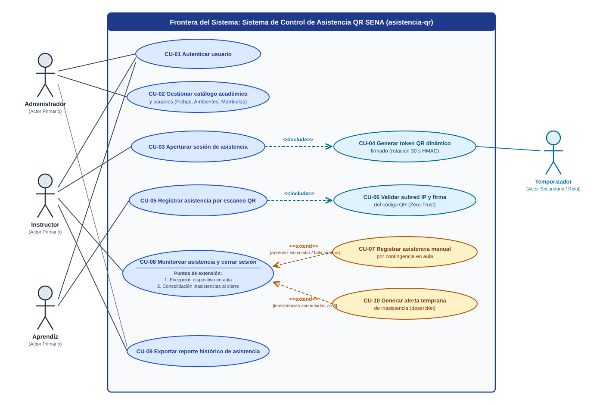

# 04 · Especificación del Diagrama de Casos de Uso UML y Justificación de Relaciones

**Proyecto:** Sistema de Control de Asistencia Académica con QR Dinámico (`asistencia-qr`)  
**Autor (GitHub):** `@estiben08`  
**RAP asociado:** 592373 · Elabora diagramas de casos de uso de acuerdo con los estándares actuales mediante UML (Criterio C4).

---

## 1. Archivos del Diagrama Entregados en esta Carpeta

- **Fuente editable Draw.io:** [`04-diagrama-casos-uso.drawio`](./04-diagrama-casos-uso.drawio)
- **Fuente editable Mermaid:** [`04-diagrama-casos-uso.mmd`](./04-diagrama-casos-uso.mmd)
- **Imagen vectorial SVG:** [`04-diagrama-casos-uso.svg`](./04-diagrama-casos-uso.svg)
- **Imagen PNG de alta resolución:** [`04-diagrama-casos-uso.png`](./04-diagrama-casos-uso.png)

---

## 2. Actores Identificados (Fuera de la Frontera del Sistema)

| Actor | Tipo de Actor | Rol en el Dominio | Casos de Uso que Inicia o con los que Interactúa |
|---|---|---|---|
| **Instructor** | Primario | Formador del SENA responsable de dirigir la sesión en el ambiente de formación, proyectar el QR, supervisar la asistencia en tiempo real, registrar contingencias justificadas y exportar reportes. | `CU-01`, `CU-03`, `CU-07`, `CU-08`, `CU-09` |
| **Aprendiz** | Primario | Estudiante matriculado en una ficha de formación que asiste presencialmente al aula, se conecta a la red WiFi institucional y escanea el código QR para registrar su asistencia. | `CU-01`, `CU-05` |
| **Administrador** | Primario | Coordinador o apoyo administrativo encargado de configurar los datos maestros del centro: usuarios, roles, ambientes de formación, fichas e inscripción de aprendices. | `CU-01`, `CU-02`, `CU-09` |
| **Temporizador del Sistema (Reloj)** | Secundario / Iniciador de eventos automáticos | Evento temporal interno/reloj que dispara la rotación automática del código QR cada 30 segundos mientras una sesión está activa y evalúa el cierre de ventana. | `CU-04` (rotación periódica), `CU-08` (expiración de ventana) |

---

## 3. Catálogo de Casos de Uso (10 Casos · Nombres en formato Verbo + Objeto)

> **Cumplimiento de la Regla de Arbitraje #1 (CRUD como casos de uso):** Las operaciones de creación, consulta, actualización e inactivación de usuarios, fichas, ambientes y matrículas comparten el mismo actor (`Administrador`) y el mismo objetivo de negocio (mantener actualizado el catálogo maestro académico), por lo que se agrupan en un único caso de uso `CU-02 Gestionar catálogo académico y usuarios`, evitando fragmentar CRUD sin justificación.

| Código | Nombre del Caso de Uso (Verbo + Objeto) | Actor Iniciador | Objetivo de Negocio | Requisitos que Atiende |
|---|---|---|---|---|
| **CU-01** | **Autenticar usuario** | `Instructor`, `Aprendiz`, `Administrador` | Verificar la identidad y el estado activo del usuario mediante sus credenciales para habilitar las funciones propias de su perfil. | `RF-01` |
| **CU-02** | **Gestionar catálogo académico y usuarios** | `Administrador` | Administrar el ciclo de vida de usuarios (instructores, aprendices), ambientes de formación, fichas y matrículas masivas de aprendices por ficha. | `RF-02`, `RF-03` |
| **CU-03** | **Aperturar sesión de asistencia** | `Instructor` | Iniciar formalmente la toma de asistencia de una ficha en un ambiente y fecha determinados, registrando la subred IP del aula y habilitando la ventana de escaneo. | `RF-04` |
| **CU-04** | **Generar token QR dinámico firmado** | Caso base `CU-03` (`«include»`) / `Temporizador` | Producir y refrescar cada 30 segundos un código QR único con marca de tiempo y firma criptográfica de integridad para proyectar en el aula. | `RF-05`, `RF-06` |
| **CU-05** | **Registrar asistencia por escaneo QR** | `Aprendiz` | Asentar la presencia del aprendiz en la sesión activa a partir de la lectura del código QR proyectado en el ambiente de formación. | `RF-07` |
| **CU-06** | **Validar subred IP y firma del código QR** | Caso base `CU-05` (`«include»`) | Comprobar obligatoriamente que el código QR sea auténtico y vigente, que el aprendiz esté conectado a la misma subred local del aula y que no tenga un registro previo en la misma sesión. | `RF-08`, `RF-09` |
| **CU-07** | **Registrar asistencia manual por contingencia** | `Instructor` (extiende a `CU-08`) | Permitir al instructor asentar o corregir manualmente la asistencia o excusa de un aprendiz presente cuando este carece de dispositivo móvil o presenta falla técnica en aula, dejando traza del motivo. | `RF-10` |
| **CU-08** | **Monitorear asistencia y cerrar sesión** | `Instructor` | Visualizar en tiempo real el listado de aprendices presentes, ausentes e intentos rechazados, y cerrar la ventana de registro consolidando las inasistencias del día. | `RF-11` |
| **CU-09** | **Exportar reporte histórico de asistencia** | `Instructor`, `Administrador` | Consultar el consolidado de asistencias e inasistencias filtrando por ficha, aprendiz o rango de fechas y descargarlo en archivo tabular compatible con hojas de cálculo. | `RF-12` |
| **CU-10** | **Generar alerta temprana de inasistencia** | Extiende a `CU-08` (`«extend»`) | Emitir automáticamente una alerta de seguimiento de deserción cuando, al cerrar la sesión, un aprendiz alcanza o supera el umbral de 3 inasistencias acumuladas en la ficha. | `RF-13` |

---

## 4. Justificación de Relaciones `«include»`, `«extend»` y Generalización (Regla de Arbitraje #2)

Cada relación incluida en el diagrama sigue estrictamente la semántica y dirección de flecha de UML 2.5:

| # | Tipo de Relación | Caso Origen (Flecha sale de) | Caso Destino (Flecha apunta a) | Punto de Extensión / Condición | Justificación en una línea (Por qué es `include` o `extend`) |
|---|---|---|---|---|---|
| **R-01** | `«include»` | `CU-03 Aperturar sesión de asistencia` | `CU-04 Generar token QR dinámico firmado` | Obligatorio en cada ejecución | **Es `«include»`** porque ninguna sesión de asistencia QR puede abrirse ni proyectarse sin generar obligatoriamente su primer token QR firmado; la flecha va del caso base (`CU-03`) al caso incluido (`CU-04`). |
| **R-02** | `«include»` | `CU-05 Registrar asistencia por escaneo QR` | `CU-06 Validar subred IP y firma del código QR` | Obligatorio en cada ejecución | **Es `«include»`** porque todo intento de registro por escaneo QR ejecuta siempre y sin excepción la verificación de vigencia, firma criptográfica, subred IP y unicidad antes de aceptar la asistencia; la flecha va del caso base (`CU-05`) al incluido (`CU-06`). |
| **R-03** | `«extend»` | `CU-07 Registrar asistencia manual por contingencia` | `CU-08 Monitorear asistencia y cerrar sesión` | **Punto de extensión:** *Excepción de dispositivo en aula*. **Condición:** `[aprendiz presente sin celular o con falla de cámara]` | **Es `«extend»`** porque el monitoreo y cierre de sesión funciona normalmente sin registros manuales; el ajuste manual solo ocurre opcionalmente cuando un aprendiz en el salón no puede escanear el QR; la flecha apunta hacia el caso base (`CU-08`). |
| **R-04** | `«extend»` | `CU-10 Generar alerta temprana de inasistencia` | `CU-08 Monitorear asistencia y cerrar sesión` | **Punto de extensión:** *Consolidación de inasistencias al cierre*. **Condición:** `[aprendiz acumula >= 3 inasistencias en la ficha]` | **Es `«extend»`** porque la alerta de deserción solo se dispara condicionalmente al cerrar la sesión si algún aprendiz ausente alcanza el umbral de tres o más fallas; la flecha apunta desde el caso que extiende (`CU-10`) hacia el caso base (`CU-08`). |
