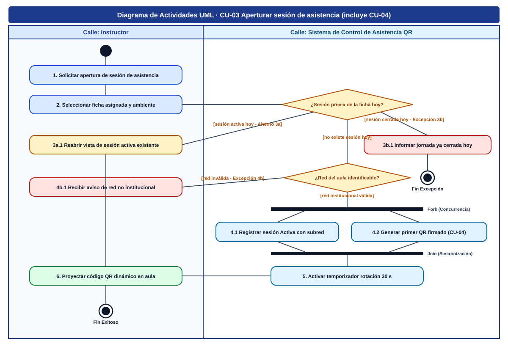
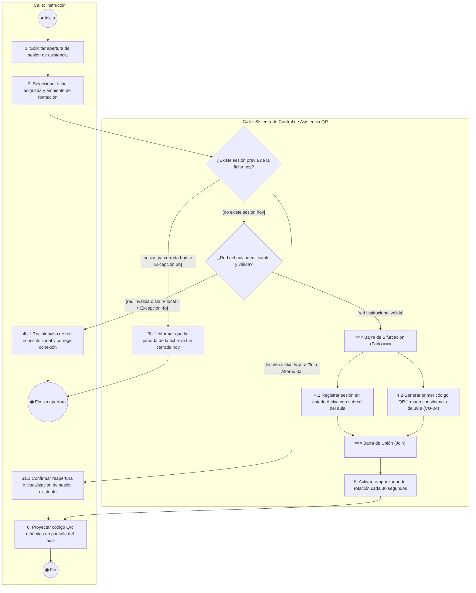
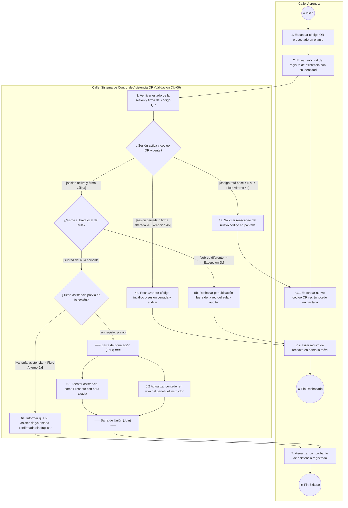
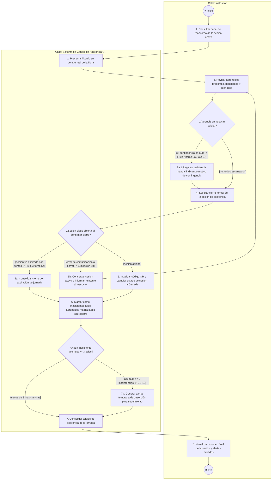

# 01 · Diagramas de Actividades UML de Casos de Uso Críticos

**Proyecto:** Sistema de Control de Asistencia Académica con QR Dinámico (`asistencia-qr`)  
**Autor (GitHub):** `@estiben08`  
**RAP asociado:** 592373 · Realiza diagramas de actividades exponiendo detalles de los casos de uso (Criterio C1).

---

## 1. Archivos Entregados

Se entregan **3 diagramas de actividades UML** (superando el mínimo exigible de 2) correspondientes a los casos de uso críticos del negocio (`CU-03`, `CU-05` y `CU-08`), cada uno con nodo de inicio, nodo de fin, calles (*swimlanes*) por actor/sistema, decisiones con guardas entre corchetes (`[...]`) que cubren todas las salidas, barra de bifurcación y unión (*fork / join*) para acciones concurrentes, y correspondencia 1 a 1 con las ramas de las plantillas extendidas (`02-plantillas-casos-uso-extendidos.md`):

1. **Diagrama de Actividades 1 (`CU-03 Aperturar sesión de asistencia` + `CU-04`):**
   - Fuente editable Draw.io: [`01-actividad-cu03-apertura-sesion.drawio`](./01-actividad-cu03-apertura-sesion.drawio)
   - Imagen SVG: [`01-actividad-cu03-apertura-sesion.svg`](./01-actividad-cu03-apertura-sesion.svg)
   - Imagen PNG: [`01-actividad-cu03-apertura-sesion.png`](./01-actividad-cu03-apertura-sesion.png)
2. **Diagrama de Actividades 2 (`CU-05 Registrar asistencia por escaneo QR` + `CU-06`):**
   - Fuente editable Draw.io: [`01-actividad-cu05-registro-asistencia-qr.drawio`](./01-actividad-cu05-registro-asistencia-qr.drawio)
   - Imagen SVG: [`01-actividad-cu05-registro-asistencia-qr.svg`](./01-actividad-cu05-registro-asistencia-qr.svg)
   - Imagen PNG: [`01-actividad-cu05-registro-asistencia-qr.png`](./01-actividad-cu05-registro-asistencia-qr.png)
3. **Diagrama de Actividades 3 (`CU-08 Monitorear asistencia y cerrar sesión` + `CU-07` y `CU-10`):**
   - Imagen SVG: [`01-actividad-cu08-monitoreo-cierre.svg`](./01-actividad-cu08-monitoreo-cierre.svg)
   - Imagen PNG: [`01-actividad-cu08-monitoreo-cierre.png`](./01-actividad-cu08-monitoreo-cierre.png)

---

## 2. Diagrama de Actividades 1: `CU-03 Aperturar sesión de asistencia` (incluye `CU-04`)

### Coherencia con la Plantilla Extendida `CU-03` y Justificación de Concurrencia:
- **Calles (*Swimlanes*):** `Instructor` y `Sistema de Control de Asistencia QR`.
- **Decisiones y guardas completas:**
  - Decisión 1 (`¿Existe sesión previa de la ficha hoy?`): `[no existe sesión hoy]` (flujo principal), `[sesión activa hoy]` (corresponde al **Flujo Alterno 3a** de la plantilla `CU-03`) y `[sesión ya cerrada hoy]` (corresponde a la **Excepción 3b** de la plantilla `CU-03`).
  - Decisión 2 (`¿Red del aula identificable y válida?`): `[red institucional válida]` (continúa al paso 4) y `[red inválida o sin IP local]` (corresponde a la **Excepción 4b** de la plantilla `CU-03`).
- **Concurrencia (`Fork / Join`):** Una vez validada la red del aula, el sistema ejecuta en paralelo (mediante bifurcación y unión) la creación del registro de sesión activa con la subred del aula y la generación criptográfica del primer código QR temporal (`CU-04`), uniendo ambos flujos antes de proyectar el QR en pantalla.

---

## 3. Diagrama de Actividades 2: `CU-05 Registrar asistencia por escaneo QR` (incluye `CU-06`)

### Coherencia con la Plantilla Extendida `CU-05` y Justificación de Concurrencia:
- **Calles (*Swimlanes*):** `Aprendiz` y `Sistema de Control de Asistencia QR`.
- **Decisiones y guardas completas:**
  - Decisión 1 (`¿Sesión activa y código QR vigente?`): `[sesión activa y firma válida]`, `[código rotó hace < 5 s]` (**Flujo Alterno 4a**: el aprendiz reescanea el código recién actualizado y logra el objetivo) y `[sesión cerrada o firma alterada]` (**Excepción 4b**).
  - Decisión 2 (`¿Misma subred local del aula?`): `[subred del aula coincide]` y `[subred diferente]` (**Excepción 5b**).
  - Decisión 3 (`¿Tiene asistencia previa en la sesión?`): `[sin registro previo]` y `[ya tenía asistencia]` (**Flujo Alterno 6a**: el sistema le muestra su comprobante existente de forma idempotente sin crear duplicado).
- **Concurrencia (`Fork / Join`):** Al aprobar las tres validaciones, el sistema bifurca la confirmación para asentar la presencia del aprendiz con marca de tiempo y actualizar concurrentemente el tablero en vivo del instructor.

---

## 4. Diagrama de Actividades 3: `CU-08 Monitorear asistencia y cerrar sesión` (con `CU-07` y `CU-10`)

