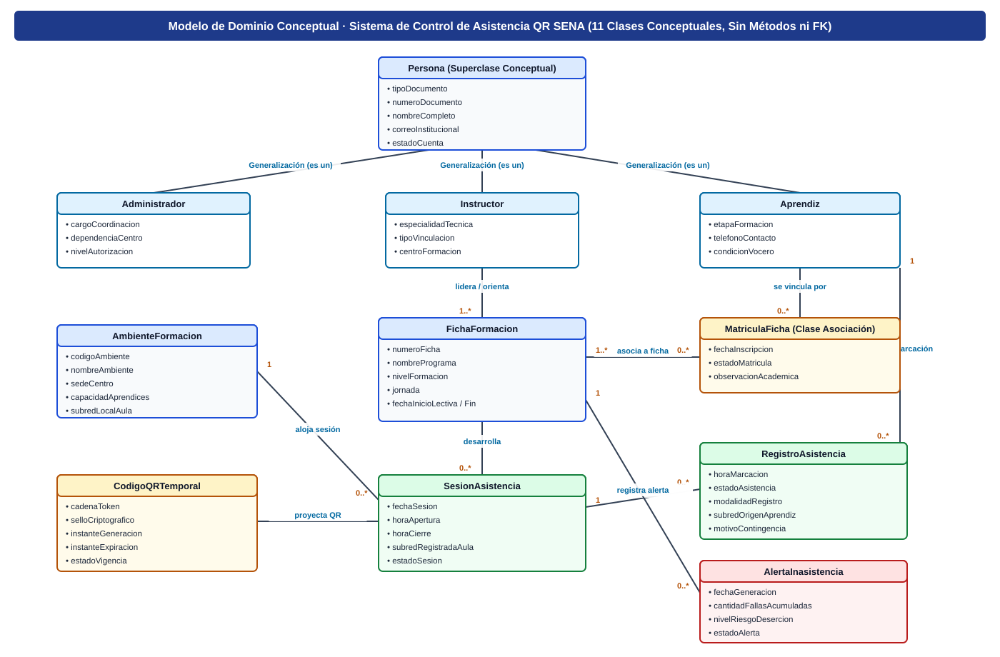

# 03 · Modelo de Dominio Conceptual

**Proyecto:** Sistema de Control de Asistencia Académica con QR Dinámico (`asistencia-qr`)  
**Autor (GitHub):** `@estiben08`  
**RAP asociado:** 592373 · Representa el negocio en término de clases abstractas generando un modelo de dominio consistente (Criterio C3).

---

## 1. Archivos del Modelo de Dominio

- **Fuente editable Draw.io:** [`03-modelo-dominio.drawio`](./03-modelo-dominio.drawio)
- **Imagen vectorial SVG:** [`03-modelo-dominio.svg`](./03-modelo-dominio.svg)
- **Imagen PNG:** [`03-modelo-dominio.png`](./03-modelo-dominio.png)



---

## 2. Cumplimiento de Reglas de Modelado Conceptual (`Rubricas_G1.md` §5.1.c y Regla de Arbitraje #5 y #10)

1. **Cantidad de clases conceptuales:** **10 clases conceptuales del negocio** (superando el mínimo de 8): `Persona`, `Instructor`, `Aprendiz`, `Administrador`, `MatriculaFicha`, `FichaFormacion`, `AmbienteFormacion`, `SesionAsistencia`, `CodigoQRTemporal`, `RegistroAsistencia` y `AlertaInasistencia` (11 conceptos en total).
2. **Atributos de negocio (mínimo 2 por clase en al menos 5 clases):** Las **11 clases** poseen entre **3 y 5 atributos propios del negocio** expresados en lenguaje conceptual.
3. **Cero métodos y cero llaves foráneas (Regla #5 y #10):** Ninguna clase del modelo de dominio incluye operaciones/métodos `()` ni atributos técnicos de base de datos como `id_ficha_fk` o tipos SQL (`VARCHAR`, `INT`). Las relaciones entre conceptos se expresan exclusivamente mediante **asociaciones rotuladas con multiplicidades**.
4. **Generalización e interfaz conceptual:** `Persona` es la superclase conceptual generalizada de `Instructor`, `Aprendiz` y `Administrador` (relación «es un»).
5. **Clase de asociación:** `MatriculaFicha` modela los atributos propios del vínculo conceptual muchos-a-muchos (`0..*` a `1..*`) entre `Aprendiz` y `FichaFormacion` (`fechaInscripcion`, `estadoVinculacion`, `jornadaAsignada`).

---

## 3.Diagrama en Notación Mermaid

```mermaid
classDiagram
  class Persona {
    tipoDocumento
    numeroDocumento
    nombreCompleto
    correoInstitucional
    estadoCuenta
  }
  class Instructor {
    especialidadTecnica
    tipoVinculacion
    centroFormacion
  }
  class Aprendiz {
    etapaFormacion
    telefonoContacto
    condicionVocero
  }
  class Administrador {
    cargoCoordinacion
    dependenciaCentro
    nivelAutorizacion
  }
  class FichaFormacion {
    numeroFicha
    nombrePrograma
    nivelFormacion
    jornada
    fechaInicioLectiva
    fechaFinLectiva
  }
  class MatriculaFicha {
    fechaInscripcion
    estadoMatricula
    observacionAcademica
  }
  class AmbienteFormacion {
    codigoAmbiente
    nombreAmbiente
    sedeCentro
    capacidadAprendices
    subredLocalAula
  }
  class SesionAsistencia {
    fechaSesion
    horaApertura
    horaCierre
    subredRegistradaAula
    estadoSesion
  }
  class CodigoQRTemporal {
    cadenaToken
    sello Criptografico
    instanteGeneracion
    instanteExpiracion
    estadoVigencia
  }
  class RegistroAsistencia {
    horaMarcacion
    estadoAsistencia
    modalidadRegistro
    subredOrigenAprendiz
    motivoContingencia
  }
  class AlertaInasistencia {
    fechaGeneracion
    cantidadFallasAcumuladas
    nivelRiesgoDesercion
    observacionSeguimiento
    estadoAlerta
  }

  Persona <|-- Instructor : Generalización
  Persona <|-- Aprendiz : Generalización
  Persona <|-- Administrador : Generalización

  Instructor "1" --> "1..*" FichaFormacion : lidera / orienta
  Aprendiz "1..*" -- "0..*" FichaFormacion : cursa en
  (Aprendiz, FichaFormacion) .. MatriculaFicha : Clase de asociación

  FichaFormacion "1" --> "0..*" SesionAsistencia : desarrolla
  Instructor "1" --> "0..*" SesionAsistencia : apertura y cierra
  AmbienteFormacion "1" --> "0..*" SesionAsistencia : aloja

  SesionAsistencia "1" *-- "1..*" CodigoQRTemporal : proyecta (cada 30 s)
  SesionAsistencia "1" *-- "0..*" RegistroAsistencia : consolida
  Aprendiz "1" --> "0..*" RegistroAsistencia : realiza

  Aprendiz "1" --> "0..*" AlertaInasistencia : presenta
  FichaFormacion "1" --> "0..*" AlertaInasistencia : registra
```

---

## 4. Diccionario Conceptual de Clases del Dominio y Coherencia con Plantillas Extendidas

| # | Clase Conceptual | Concepto del Negocio que Representa | Atributos de Negocio (Sin FK ni tipos técnicos) | Plantillas donde Aparece (`CU`) |
|---|---|---|---|---|
| 1 | **`Persona`** *(Superclase)* | Individuo vinculado al centro de formación del SENA con identidad única institucional. | `tipoDocumento`, `numeroDocumento`, `nombreCompleto`, `correoInstitucional`, `estadoCuenta` | `CU-01`, `CU-03`, `CU-05`, `CU-08`, `CU-09` |
| 2 | **`Instructor`** *(Subclase)* | Formador encargado de orientar fichas, abrir sesiones QR, validar contingencias y emitir reportes. | `especialidadTecnica`, `tipoVinculacion`, `centroFormacion` | `CU-03`, `CU-08`, `CU-09` |
| 3 | **`Aprendiz`** *(Subclase)* | Estudiante en formación que asiste al ambiente y marca su asistencia escaneando el código QR. | `etapaFormacion`, `telefonoContacto`, `condicionVocero` | `CU-05`, `CU-08`, `CU-09` |
| 4 | **`Administrador`** *(Subclase)* | Funcionario o coordinador responsable de administrar usuarios, ambientes, fichas y matrículas. | `cargoCoordinacion`, `dependenciaCentro`, `nivelAutorizacion` | `CU-02`, `CU-09` |
| 5 | **`FichaFormacion`** | Grupo académico formal de un programa de formación (ej. Ficha 3413974 ADSO). | `numeroFicha`, `nombrePrograma`, `nivelFormacion`, `jornada`, `fechaInicioLectiva`, `fechaFinLectiva` | `CU-03`, `CU-05`, `CU-08`, `CU-09` |
| 6 | **`MatriculaFicha`** *(Clase de asociación)* | Vínculo académico formal que acredita la inscripción y estado de un aprendiz dentro de una ficha. | `fechaInscripcion`, `estadoMatricula`, `observacionAcademica` | `CU-03`, `CU-05`, `CU-08` |
| 7 | **`AmbienteFormacion`** | Salón, laboratorio o taller físico dotado de conectividad de red local donde se imparte la sesión. | `codigoAmbiente`, `nombreAmbiente`, `sedeCentro`, `capacidadAprendices`, `subredLocalAula` | `CU-03`, `CU-05` |
| 8 | **`SesionAsistencia`** | Jornada de clase abierta por un instructor para una ficha en una fecha y ambiente específicos. | `fechaSesion`, `horaApertura`, `horaCierre`, `subredRegistradaAula`, `estadoSesion` | `CU-03`, `CU-05`, `CU-08`, `CU-09` |
| 9 | **`CodigoQRTemporal`** | Imagen codificada y firmada con vigencia de 30 segundos proyectada durante una sesión activa. | `cadenaToken`, `selloCriptografico`, `instanteGeneracion`, `instanteExpiracion`, `estadoVigencia` | `CU-03`, `CU-05`, `CU-08` |
| 10 | **`RegistroAsistencia`** | Asiento individual que certifica la presencia, contingencia, excusa o inasistencia de un aprendiz en una sesión. | `horaMarcacion`, `estadoAsistencia`, `modalidadRegistro`, `subredOrigenAprendiz`, `motivoContingencia` | `CU-05`, `CU-08`, `CU-09` |
| 11 | **`AlertaInasistencia`** | Aviso preventivo generado cuando un aprendiz alcanza tres o más inasistencias acumuladas en una ficha. | `fechaGeneracion`, `cantidadFallasAcumuladas`, `nivelRiesgoDesercion`, `observacionSeguimiento`, `estadoAlerta` | `CU-08`, `CU-09` |
