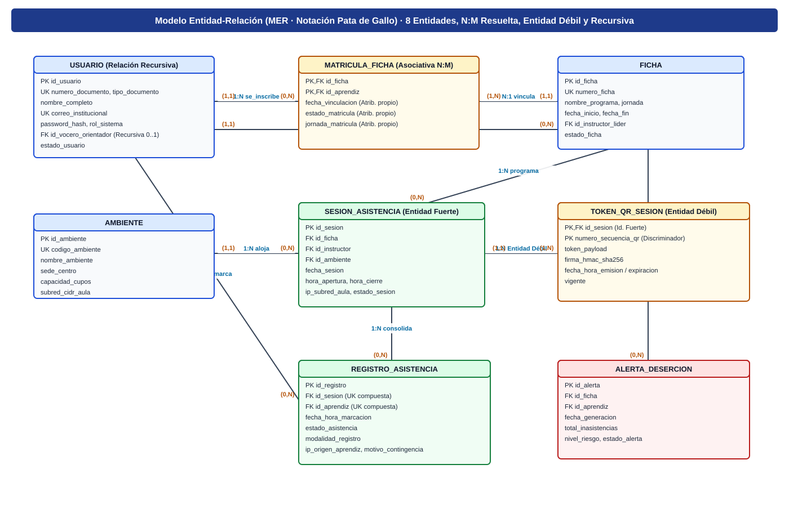
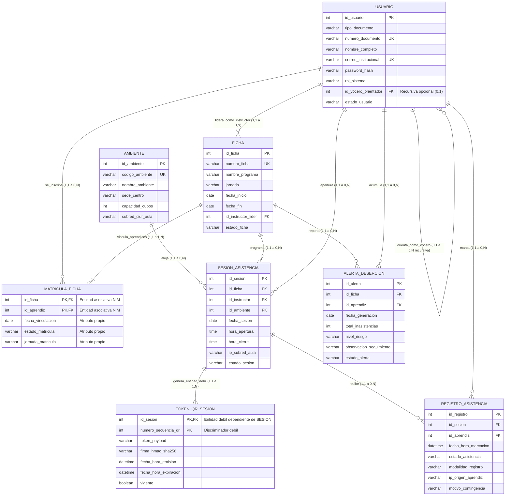

# 04 · Modelo Entidad-Relación (MER)

**Proyecto:** Sistema de Control de Asistencia Académica con QR Dinámico (`asistencia-qr`)  
**Autor (GitHub):** `@estiben08`  
**RAP asociado:** 592373 · Elabora el modelo entidad relación de acuerdo con los requisitos del software (Criterio C4).

---

## 1. Declaración Explícita de Notación

- **Notación utilizada:** **Pata de Gallo (*Crow's Foot*) con indicación explícita de cardinalidad mínima y máxima `(mín, máx)` y participación total (obligatoria, `1`) o parcial (opcional, `0`)** en ambos extremos de cada relación.
- **Archivos entregados:**
  - Fuente editable Draw.io: [`04-modelo-entidad-relacion.drawio`](./04-modelo-entidad-relacion.drawio)
  - Imagen vectorial SVG: [`04-modelo-entidad-relacion.svg`](./04-modelo-entidad-relacion.svg)
  - Imagen PNG: [`04-modelo-entidad-relacion.png`](./04-modelo-entidad-relacion.png)

---

## 2. Cumplimiento de Todos los Elementos Exigidos por la Rúbrica (`Rubricas_G1.md` §5.1.d)

1. **Al menos 6 entidades con identificadores, cardinalidad y participación:** Se modelan **8 entidades** (`USUARIO`, `FICHA`, `MATRICULA_FICHA`, `AMBIENTE`, `SESION_ASISTENCIA`, `TOKEN_QR_SESION`, `REGISTRO_ASISTENCIA`, `ALERTA_DESERCION`), cada una con su identificador primario (`PK`) y atributos que soportan el 100 % de los requisitos de datos.
2. **Al menos 1 relación `N:M` resuelta con entidad asociativa y atributos propios:** La relación muchos-a-muchos entre `USUARIO` (en rol aprendiz) y `FICHA` se resuelve mediante la **entidad asociativa `MATRICULA_FICHA`**, que posee llave primaria compuesta `(id_ficha, id_aprendiz)` y **atributos propios del vínculo**: `fecha_vinculacion`, `estado_matricula`, `jornada_matricula` y `observacion_academica`.
3. **Al menos 1 entidad débil:** **`TOKEN_QR_SESION`** es una **entidad débil por dependencia de existencia e identificación** respecto de la entidad fuerte `SESION_ASISTENCIA`: ningún código QR rotativo puede existir sin una sesión de asistencia activa, y se identifica mediante su discriminador `numero_secuencia_qr` combinado con `id_sesion`.
4. **Al menos 1 relación recursiva:** La entidad **`USUARIO`** posee la relación recursiva unaria **`orienta_como_vocero` (`id_vocero_orientador`)**, con cardinalidad `(0,1)` a `(0,N)` (participación parcial en ambos extremos): un aprendiz con condición de vocero de ficha puede acompañar/orientar a cero o muchos aprendices de su ficha, y un aprendiz puede tener asignado cero o un vocero orientador.

---

## 3. Diagrama Entidad-Relación en Mermaid (`erDiagram`)

---

## 4. Especificación de Relaciones, Cardinalidades y Participación

| # | Entidad A | Relación (Verbo) | Entidad B | Cardinalidad Máxima | Cardinalidad `(mín, máx)` en A → B | Participación en A y B |
|---|---|---|---|---|---|---|
| 1 | `USUARIO` (Aprendiz) | `se_matricula_en` → resuelta por **`MATRICULA_FICHA`** | `FICHA` | **`N:M` resuelta en dos `1:N`** | `USUARIO (1,1)` — `(0,N) MATRICULA_FICHA (1,N)` — `(1,1) FICHA` | Total en `MATRICULA_FICHA`; toda ficha activa tiene al menos 1 matrícula `(1,N)`. |
| 2 | `SESION_ASISTENCIA` (Fuerte) | `genera` (Relación identificadora) | **`TOKEN_QR_SESION` (Entidad Débil)** | **`1:N` identificadora** | `SESION_ASISTENCIA (1,1)` — `(1,N) TOKEN_QR_SESION` | **Participación Total** en ambos lados: todo token QR depende de una sesión `(1,1)` y toda sesión abierta genera al menos un token QR `(1,N)`. |
| 3 | `USUARIO` (Vocero) | **`orienta_como_vocero` (Recursiva)** | `USUARIO` (Aprendiz) | **`1:N` unaria recursiva** | `Vocero (0,1)` — `(0,N) Aprendiz orientado` | **Participación Parcial** en ambos roles: no todo usuario es vocero y un aprendiz puede tener 0 o 1 vocero. |
| 4 | `FICHA` | `programa` | `SESION_ASISTENCIA` | `1:N` | `FICHA (1,1)` — `(0,N) SESION_ASISTENCIA` | Total en `SESION_ASISTENCIA` (toda sesión pertenece a una ficha); parcial en `FICHA` (una ficha recién creada puede tener 0 sesiones). |
| 5 | `AMBIENTE` | `aloja` | `SESION_ASISTENCIA` | `1:N` | `AMBIENTE (1,1)` — `(0,N) SESION_ASISTENCIA` | Total en `SESION_ASISTENCIA`; parcial en `AMBIENTE`. |
| 6 | `SESION_ASISTENCIA` | `registra` | `REGISTRO_ASISTENCIA` | `1:N` | `SESION_ASISTENCIA (1,1)` — `(0,N) REGISTRO_ASISTENCIA` | Total en `REGISTRO_ASISTENCIA`; restricción de unicidad `(id_sesion, id_aprendiz)` para impedir doble asistencia (`RF-09`). |
| 7 | `USUARIO` (Aprendiz) | `acumula` | `ALERTA_DESERCION` | `1:N` | `USUARIO (1,1)` — `(0,N) ALERTA_DESERCION` | Total en `ALERTA_DESERCION`; parcial en `USUARIO` (solo quienes acumulan ≥ 3 fallas tienen alerta). |
