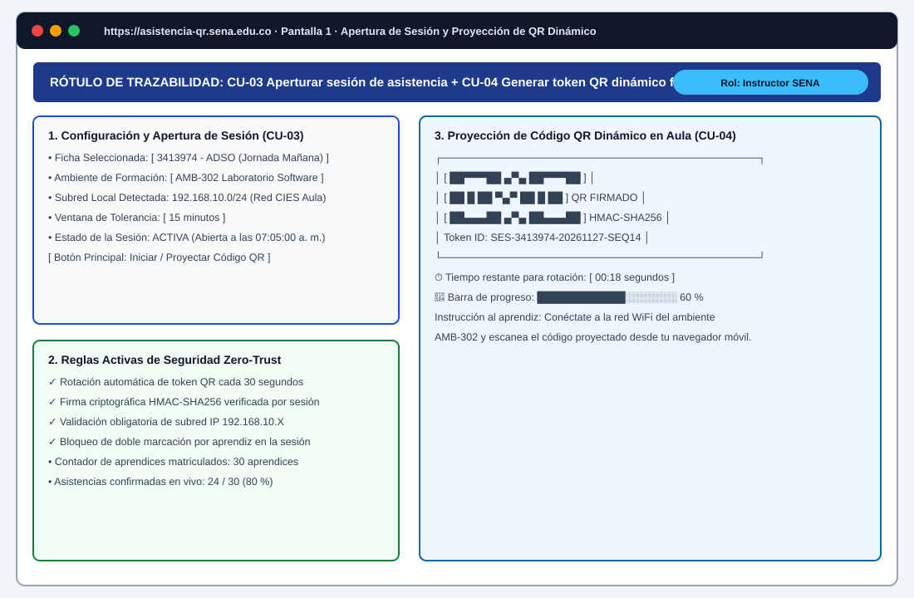
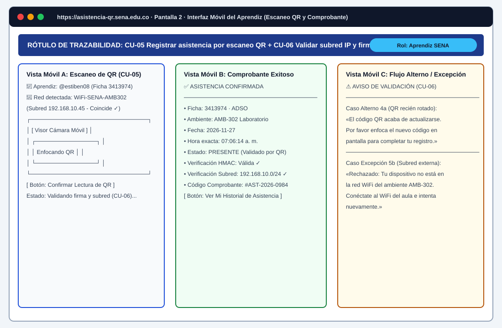
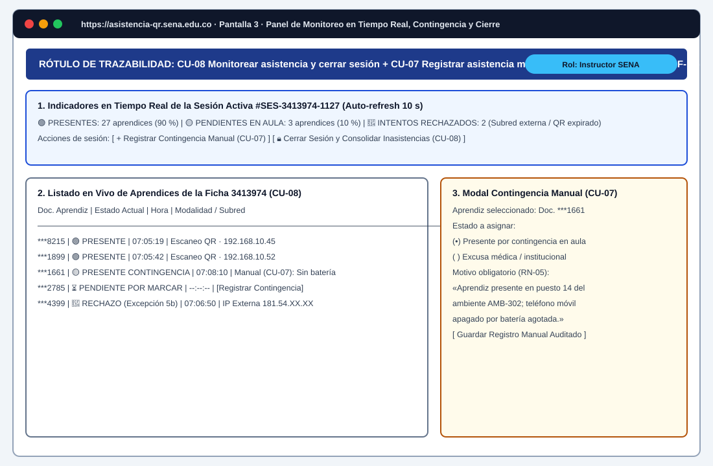
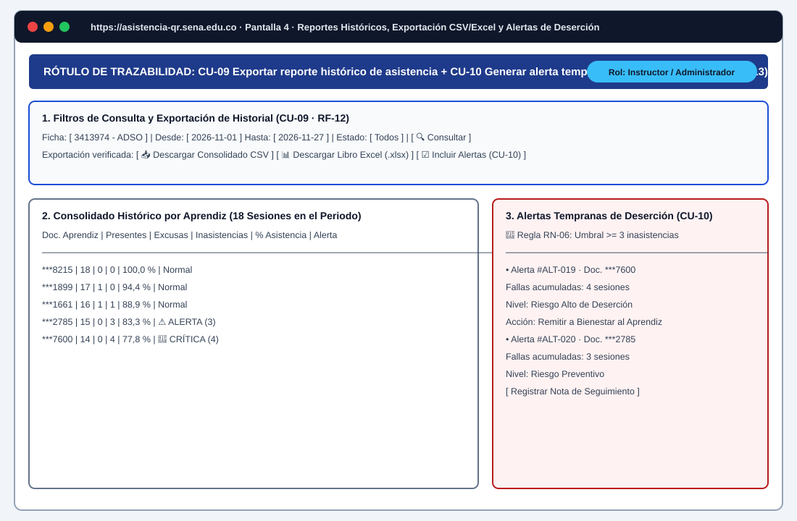

# 05 · Prototipo Inicial del Software (Mockups Rotulados por Caso de Uso)

**Proyecto:** Sistema de Control de Asistencia Académica con QR Dinámico (`asistencia-qr`)  
**Autor (GitHub):** `@estiben08`  
**RAP asociado:** 592374 · Realiza prototipo inicial del software de acuerdo con los casos de uso identificados (Criterio C5).  
**Insumo reutilizado y ajustado:** `03-execute/17-week/02-optional-activity/asistencia_qr_mockup (1).html` y `03-execute/16-week/02-optional-activity/SENA_Control_Asistencia_Mockup.pptx`.

---

## 1. Índice de Pantallas del Prototipo y Trazabilidad a Casos de Uso (Cero Pantallas Huérfanas)

Cada una de las **4 pantallas del prototipo** (superando el mínimo exigible de 3) lleva un rótulo superior explícito con el código y nombre del caso de uso que atiende y los requisitos funcionales asociados:

| # | Pantalla del Prototipo | Caso(s) de Uso que Atiende (Rótulo) | Requisitos Funcionales | Actor Usuario | Archivos Entregados |
|---|---|---|---|---|---|
| **1** | **Pantalla 1 · Apertura de Sesión y Proyección de QR Dinámico** | `CU-03 Aperturar sesión de asistencia` y `CU-04 Generar token QR dinámico firmado` | `RF-04`, `RF-05`, `RF-06` | `Instructor` | [`05-pantalla-1-apertura-qr.svg`](./05-pantalla-1-apertura-qr.svg) · [`05-pantalla-1-apertura-qr.png`](./05-pantalla-1-apertura-qr.png) |
| **2** | **Pantalla 2 · Interfaz Móvil del Aprendiz (Escaneo QR, Comprobante y Mensajes de Excepción)** | `CU-05 Registrar asistencia por escaneo QR` y `CU-06 Validar subred IP y firma del código QR` | `RF-07`, `RF-08`, `RF-09` | `Aprendiz` | [`05-pantalla-2-escaneo-aprendiz.svg`](./05-pantalla-2-escaneo-aprendiz.svg) · [`05-pantalla-2-escaneo-aprendiz.png`](./05-pantalla-2-escaneo-aprendiz.png) |
| **3** | **Pantalla 3 · Panel de Monitoreo en Tiempo Real, Contingencia Manual y Cierre de Sesión** | `CU-08 Monitorear asistencia y cerrar sesión` y `CU-07 Registrar asistencia manual por contingencia` | `RF-10`, `RF-11` | `Instructor` | [`05-pantalla-3-monitoreo-cierre.svg`](./05-pantalla-3-monitoreo-cierre.svg) · [`05-pantalla-3-monitoreo-cierre.png`](./05-pantalla-3-monitoreo-cierre.png) |
| **4** | **Pantalla 4 · Consulta de Historial, Exportación CSV/Excel y Alertas Tempranas de Deserción** | `CU-09 Exportar reporte histórico de asistencia` y `CU-10 Generar alerta temprana de inasistencia` | `RF-12`, `RF-13` | `Instructor`, `Administrador` | [`05-pantalla-4-reportes-alertas.svg`](./05-pantalla-4-reportes-alertas.svg) · [`05-pantalla-4-reportes-alertas.png`](./05-pantalla-4-reportes-alertas.png) |

---

## 2. Visualización de las 4 Pantallas Rotuladas

### Pantalla 1 · `CU-03 Aperturar sesión de asistencia` + `CU-04 Generar token QR dinámico firmado`

### Pantalla 2 · `CU-05 Registrar asistencia por escaneo QR` + `CU-06 Validar subred IP y firma del código QR`

### Pantalla 3 · `CU-08 Monitorear asistencia y cerrar sesión` + `CU-07 Registrar asistencia manual por contingencia`

### Pantalla 4 · `CU-09 Exportar reporte histórico de asistencia` + `CU-10 Generar alerta temprana de inasistencia`

