# A2 · Diagrama de Clases de Diseño Orientado a Objetos

**Proyecto:** Sistema de Control de Asistencia Académica con QR Dinámico (`asistencia-qr`)  
**Autor (GitHub):** `@estiben08` · **Ficha:** 3413974  
**RAP asociado:** 593103 (01) · Define los entregables de diseño siguiendo los conceptos y principios de orientación a objetos. Crea el diagrama de clases de acuerdo con los requisitos (Criterio 2).

---

## 1. Archivos del Diagrama de Clases

- **Fuente editable Draw.io:** [`A2-diagrama-clases.drawio`](./A2-diagrama-clases.drawio)
- **Fuente editable Mermaid:** [`A2-diagrama-clases.mmd`](./A2-diagrama-clases.mmd)
- **Imagen vectorial SVG:** [`A2-diagrama-clases.svg`](./A2-diagrama-clases.svg)
- **Imagen PNG:** [`A2-diagrama-clases.png`](./A2-diagrama-clases.png)

---

## 2. Verificación de Principios de Orientación a Objetos y Mínimos de la Rúbrica

1. **Cantidad de clases (≥ 8 exigidas):** El diagrama modela **18 elementos orientados a objetos** (**16 clases concretas/abstractas y 2 interfaces**), todos con visibilidad (`-` privado, `#` protegido, `+` público), atributos tipados (`int`, `str`, `date`, `time`, `datetime`, `bool`) y métodos con parámetros tipados y tipo de retorno.
2. **Herencia («es un»):** La clase abstracta `Usuario` define el estado y comportamiento común de autenticación y es heredada por `Administrador`, `Instructor` y `Aprendiz`, que sobrescriben polimórficamente `+obtenerRol(): str`.
3. **Interfaces y Polimorfismo (≥ 1 interfaz con ≥ 2 implementaciones):**
   - `<<interface>> IReglaValidacionAsistencia` cuenta con **3 implementaciones concretas**: `ValidadorFirmaHMAC`, `ValidadorSubredIP` y `ValidadorUnicidadSesion`. `ServicioControlAsistencia` invoca `+validar(solicitud, sesion)` sobre la interfaz sin conocer la clase concreta.
   - `<<interface>> IExportadorReporte` cuenta con **2 implementaciones concretas**: `ExportadorCSV` y `ExportadorExcel`.
4. **Composición (`*--`) y Agregación (`o--`) usadas con criterio («es parte de»):**
   - **Composición fuerte (`*--`):** `SesionAsistencia "1" *-- "1..*" TokenQRSesion` y `SesionAsistencia "1" *-- "0..*" RegistroAsistencia` (los tokens QR de una sesión y sus registros de asistencia son parte constitutiva del ciclo de vida de la sesión).
   - **Agregación (`o--`):** `FichaFormacion "1" o-- "1..*" MatriculaFicha` y `ServicioControlAsistencia "1" o-- "1..*" IReglaValidacionAsistencia` (las estrategias de validación se inyectan en el servicio y pueden existir independientemente).
5. **Alta cohesión y bajo acoplamiento (Regla 5 de §1.2 de `Rubricas_G2.md`):** Ninguna clase mezcla responsabilidades de áreas distintas:
   - Las clases de dominio (`Usuario`, `FichaFormacion`, `AmbienteFormacion`, `SesionAsistencia`, `TokenQRSesion`, `RegistroAsistencia`, `AlertaInasistencia`) encapsulan únicamente estado y reglas propias de su entidad.
   - La validación antifraude está desacoplada en `ValidadorFirmaHMAC`, `ValidadorSubredIP` y `ValidadorUnicidadSesion`.
   - La generación de archivos descargables está aislada en `ExportadorCSV`, `ExportadorExcel` y `FabricaExportadorReporte`.

---

## 3. Código Mermaid del Diagrama de Clases

```mermaid
classDiagram
  class Usuario {
    <<abstract>>
    #idUsuario: int
    #tipoDocumento: str
    #numeroDocumento: str
    #nombreCompleto: str
    #correoInstitucional: str
    -passwordHash: str
    #estadoUsuario: str
    +autenticar(passwordPlano: str) bool
    +esActivo() bool
    +obtenerRol()* str
  }

  class Administrador {
    -cargoCoordinacion: str
    -dependenciaCentro: str
    +obtenerRol() str
    +autorizarCreacionFicha(codigo: str) bool
  }

  class Instructor {
    -especialidadTecnica: str
    -tipoVinculacion: str
    +obtenerRol() str
    +puedeAperturarFicha(idFicha: int) bool
  }

  class Aprendiz {
    -etapaFormacion: str
    -esVocero: bool
    -idVoceroOrientador: Optional~int~
    +obtenerRol() str
    +solicitarMarcacionQR(token: str, ipOrigen: str) SolicitudEscaneo
  }

  class FichaFormacion {
    -idFicha: int
    -numeroFicha: str
    -nombrePrograma: str
    -jornada: str
    -fechaInicio: date
    -fechaFin: date
    -estadoFicha: str
    +estaVigente(fechaActual: date) bool
    +contarAprendicesActivos() int
  }

  class MatriculaFicha {
    -idFicha: int
    -idAprendiz: int
    -fechaVinculacion: date
    -estadoMatricula: str
    +activarMatricula() void
    +retirarAprendiz(motivo: str) void
  }

  class AmbienteFormacion {
    -idAmbiente: int
    -codigoAmbiente: str
    -nombreAmbiente: str
    -capacidadCupos: int
    -subredCidrAula: str
    +perteneceASubred(ipCliente: str) bool
  }

  class SesionAsistencia {
    -idSesion: int
    -idFicha: int
    -idInstructor: int
    -idAmbiente: int
    -fechaSesion: date
    -horaApertura: time
    -horaCierre: Optional~time~
    -ipSubredAula: str
    -estadoSesion: str
    +activarSesion() void
    +rotarTokenQR(secretoHmac: str) TokenQRSesion
    +cerrarSesion(horaFin: time) int
  }

  class TokenQRSesion {
    -idTokenQr: int
    -idSesion: int
    -numeroSecuencia: int
    -tokenPayload: str
    -firmaHmacSha256: str
    -fechaHoraEmision: datetime
    -fechaHoraExpiracion: datetime
    -vigente: bool
    +estaVigente(ahora: datetime) bool
    +verificarFirma(secretoHmac: str) bool
  }

  class RegistroAsistencia {
    -idRegistro: int
    -idSesion: int
    -idAprendiz: int
    -fechaHoraMarcacion: datetime
    -estadoAsistencia: str
    -modalidadRegistro: str
    -ipOrigenAprendiz: str
    -motivoContingencia: Optional~str~
    +marcarContingencia(motivo: str, idInstructor: int) void
    +esPresente() bool
  }

  class AlertaInasistencia {
    -idAlerta: int
    -idFicha: int
    -idAprendiz: int
    -fechaGeneracion: date
    -totalInasistencias: int
    -nivelRiesgo: str
    -estadoAlerta: str
    +superaUmbralCritico() bool
    +registrarSeguimiento(nota: str) void
  }

  class IReglaValidacionAsistencia {
    <<interface>>
    +validar(solicitud: SolicitudEscaneo, sesion: SesionAsistencia) ResultadoValidacion
  }

  class ValidadorFirmaHMAC {
    -secretoServidor: str
    -toleranciaSegundos: int
    +validar(solicitud: SolicitudEscaneo, sesion: SesionAsistencia) ResultadoValidacion
  }

  class ValidadorSubredIP {
    -mascaraPrefijo: int
    +validar(solicitud: SolicitudEscaneo, sesion: SesionAsistencia) ResultadoValidacion
  }

  class ValidadorUnicidadSesion {
    +validar(solicitud: SolicitudEscaneo, sesion: SesionAsistencia) ResultadoValidacion
  }

  class ServicioControlAsistencia {
    -reglasValidacion: List~IReglaValidacionAsistencia~
    +aperturarSesion(idFicha: int, idInst: int, idAmb: int, ip: str) SesionAsistencia
    +procesarEscaneoQR(solicitud: SolicitudEscaneo) RegistroAsistencia
    +cerrarYConsolidarFallas(idSesion: int) List~AlertaInasistencia~
  }

  class IExportadorReporte {
    <<interface>>
    +exportar(registros: List~RegistroAsistencia~) bytes
  }

  class ExportadorCSV {
    -delimitador: str
    +exportar(registros: List~RegistroAsistencia~) bytes
  }

  class ExportadorExcel {
    -incluirHojaAlertas: bool
    +exportar(registros: List~RegistroAsistencia~) bytes
  }

  class FabricaExportadorReporte {
    +crearExportador(formato: str) IExportadorReporte
  }

  Usuario <|-- Administrador
  Usuario <|-- Instructor
  Usuario <|-- Aprendiz

  Instructor "1" --> "1..*" FichaFormacion : lidera
  FichaFormacion "1" o-- "1..*" MatriculaFicha : agrupa
  Aprendiz "1" --> "0..*" MatriculaFicha : posee
  Instructor "1" --> "0..*" SesionAsistencia : dirige
  FichaFormacion "1" --> "0..*" SesionAsistencia : desarrolla
  AmbienteFormacion "1" --> "0..*" SesionAsistencia : aloja

  SesionAsistencia "1" *-- "1..*" TokenQRSesion : compone
  SesionAsistencia "1" *-- "0..*" RegistroAsistencia : compone
  Aprendiz "1" --> "0..*" RegistroAsistencia : registra
  Aprendiz "1" --> "0..*" AlertaInasistencia : acumula
  FichaFormacion "1" --> "0..*" AlertaInasistencia : reporta

  ServicioControlAsistencia "1" o-- "1..*" IReglaValidacionAsistencia : ejecuta estrategias
  IReglaValidacionAsistencia <|.. ValidadorFirmaHMAC
  IReglaValidacionAsistencia <|.. ValidadorSubredIP
  IReglaValidacionAsistencia <|.. ValidadorUnicidadSesion

  FabricaExportadorReporte ..> IExportadorReporte : instancia
  IExportadorReporte <|.. ExportadorCSV
  IExportadorReporte <|.. ExportadorExcel

```

---

## 4. Tabla de Responsabilidad única (Alta Cohesión) y Trazabilidad por Clase

| # | Clase / Interfaz | Área de Responsabilidad Única (Cohesión) | Requisito(s) que Atiende |
|---|---|---|---|
| 1 | `Usuario` *(abstracta)* | Identidad institucional, verificación de hash de contraseña y estado de cuenta. | `RF-01`, `RNF-02` |
| 2 | `Administrador` | Reglas de autorización para configuración de catálogo académico del centro. | `RF-01`, `RF-02`, `RF-03` |
| 3 | `Instructor` | Verificación de asignación docente sobre fichas y dirección de sesiones. | `RF-01`, `RF-04`, `RF-10`, `RF-11` |
| 4 | `Aprendiz` | Construcción de solicitud de marcación QR y vínculo con vocero orientador. | `RF-01`, `RF-07` |
| 5 | `FichaFormacion` | Gestión de vigencia lectiva y conteo de aprendices matriculados en el grupo. | `RF-02`, `RF-03`, `RF-04` |
| 6 | `MatriculaFicha` | Estado de inscripción (`ACTIVA`, `RETIRADO`) de un aprendiz dentro de una ficha. | `RF-03`, `RF-11` |
| 7 | `AmbienteFormacion` | Datos del aula física y comprobación CIDR de pertenencia a subred local. | `RF-02`, `RF-04`, `RF-08` |
| 8 | `SesionAsistencia` | Ciclo de vida de la sesión (`ACTIVA`, `CERRADA`), rotación de QR y cierre. | `RF-04`, `RF-06`, `RF-11` |
| 9 | `TokenQRSesion` | Ventana de validez de 30 segundos y verificación de firma `HMAC-SHA256`. | `RF-05`, `RF-06`, `RNF-02` |
| 10 | `RegistroAsistencia` | Estado individual de asistencia (`PRESENTE`, `CONTINGENCIA`, `EXCUSA`, `INASISTENTE`). | `RF-07`, `RF-09`, `RF-10`, `RF-11` |
| 11 | `AlertaInasistencia` | Evaluación de umbral de `>= 3` fallas acumuladas y notas de seguimiento. | `RF-13` |
| 12 | `IReglaValidacionAsistencia` | Contrato polimórfico para reglas de validación antifraude en escaneo QR. | `RF-08`, `RF-09`, `RNF-05` |
| 13 | `ValidadorFirmaHMAC` | Validación criptográfica `HMAC-SHA256` y expiración de ventana de 30 s. | `RF-05`, `RF-06`, `RF-08`, `RNF-02` |
| 14 | `ValidadorSubredIP` | Comparación de prefijo de red local entre la IP del aula y la IP del móvil. | `RF-08`, `RNF-02` |
| 15 | `ValidadorUnicidadSesion` | Prevención de doble asistencia de un mismo aprendiz en la sesión activa. | `RF-09` |
| 16 | `ServicioControlAsistencia` | Orquestación de apertura, evaluación de cadena de validadores y cierre. | `RF-04`, `RF-07`, `RF-08`, `RF-11`, `RF-13` |
| 17 | `IExportadorReporte` / `ExportadorCSV` / `ExportadorExcel` | Serialización tabular de reportes históricos sin acoplar la lógica de dominio. | `RF-12`, `RNF-05` |
| 18 | `FabricaExportadorReporte` | Instanciación desacoplada del exportador según el formato pedido por el actor. | `RF-12`, `RNF-05` |
