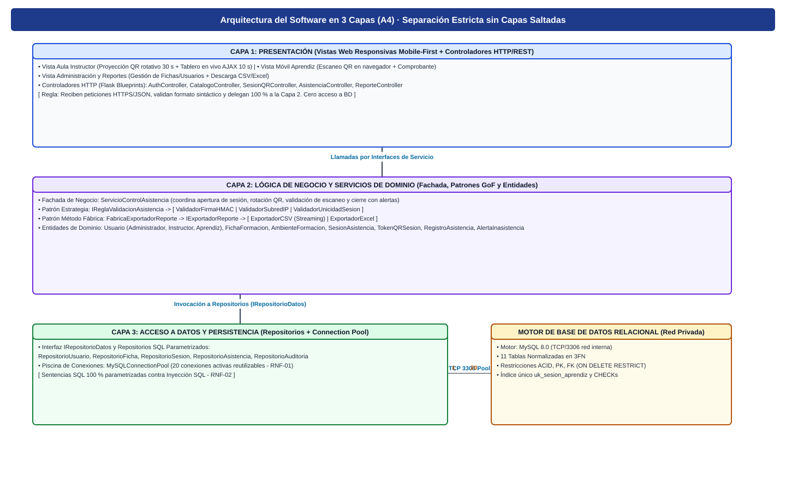
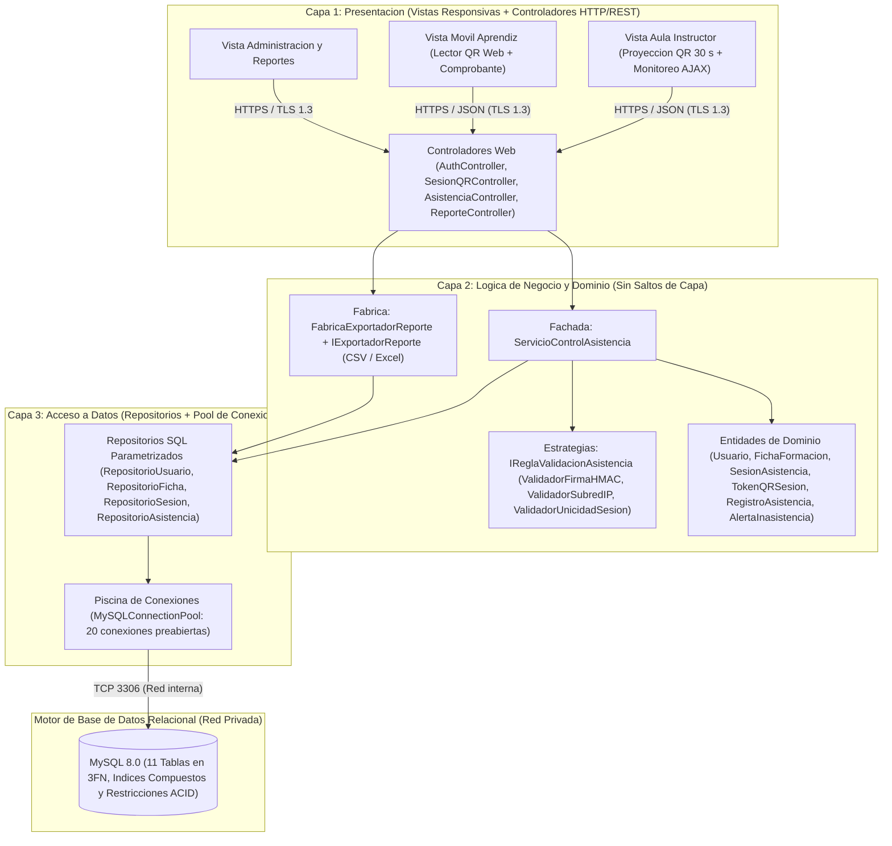

# A4 · Arquitectura del Software y Tabla de Decisiones frente a Requisitos No Funcionales

**Proyecto:** Sistema de Control de Asistencia Académica con QR Dinámico (`asistencia-qr`)  
**Autor (GitHub):** `@estiben08` · **Ficha:** 3413974  
**RAP asociado:** 593103 (01) · Define la arquitectura del software dando cumplimiento a los requisitos funcionales y no funcionales (Criterio 4).

---

## 1. Archivos del Diagrama de Arquitectura

- **Fuente editable Draw.io:** [`A4-arquitectura.drawio`](./A4-arquitectura.drawio)
- **Imagen vectorial SVG:** [`A4-arquitectura.svg`](./A4-arquitectura.svg)
- **Imagen PNG:** [`A4-arquitectura.png`](./A4-arquitectura.png)

---

## 2. Estilo Arquitectónico Seleccionado y Regla Estricta de Comunicación entre Capas

- **Estilo arquitectónico:** **Arquitectura Cliente-Servidor en Tres Capas Lógicas (*3-Tier Layered Architecture*) con separación MVC en la capa web y Servicios de Dominio en la capa de lógica de negocio**:
  1. **Capa 1 · Presentación (*Presentation Layer*):** Vistas responsivas HTML5/CSS3/JS (*Mobile-First* para el aprendiz y tablero de proyección para el instructor) y Controladores Web (Flask Blueprints) que únicamente reciben peticiones HTTP/JSON, validan formato de entrada y delegan en la capa de negocio.
  2. **Capa 2 · Lógica de Negocio y Servicios de Dominio (*Business Logic & Domain Layer*):** Contiene la fachada `ServicioControlAsistencia`, las estrategias polimórficas `IReglaValidacionAsistencia` (`ValidadorFirmaHMAC`, `ValidadorSubredIP`, `ValidadorUnicidadSesion`), la fábrica `FabricaExportadorReporte` y las entidades de dominio.
  3. **Capa 3 · Acceso a Datos y Persistencia (*Data Access & Persistence Layer*):** Repositorios parametrizados (`RepositorioUsuario`, `RepositorioFicha`, `RepositorioSesion`, `RepositorioAsistencia`) que gestionan el *Connection Pool* hacia el motor relacional **MySQL 8.0**.
- **Regla arquitectónica sin capas saltadas:** **La Capa de Presentación jamás accede directamente a la Capa de Datos ni ejecuta sentencias SQL.** Toda petición pasa obligatoriamente de `Presentación → Lógica de Negocio → Acceso a Datos → Motor MySQL`.
- **Estilo de comunicación entre componentes:**
  - Entre el navegador (PC Instructor / Móvil Aprendiz) y el Servidor de Aplicación: **Peticiones HTTPS sobre TLS 1.3 (puerto 443)**: vistas renderizadas para navegación inicial y endpoints **REST/JSON asíncronos (`fetch` / AJAX)** para la rotación del código QR cada 30 segundos, el envío del escaneo móvil y el refresco del tablero en vivo cada 10 segundos.
  - Entre las capas internas del servidor: llamadas síncronas a través de **interfaces formales (`IReglaValidacionAsistencia`, `IExportadorReporte`, `IRepositorioDatos`)**.
  - Entre la Capa de Acceso a Datos y el Motor MySQL: protocolo binario **MySQL sobre TCP/3306 en red privada interna** mediante piscina de conexiones reutilizables (`MySQLConnectionPool`).

---

## 3. Diagrama de Arquitectura en Mermaid

---

## 4. Tabla de Decisiones Arquitectónicas frente a Requisitos No Funcionales (5 RNF · Mínimo Exigible: 3)

| RNF | Métrica del Requisito | Decisión de Diseño Arquitectónico | Alternativa Descartada | Razón Técnica del Descarte |
|---|---|---|---|---|
| **RNF-01 (Desempeño en ráfaga de escaneo)** | Validación de escaneo QR `<= 1,5 s (p95)` con 35 aprendices simultáneos en 30 s. | **Piscina de conexiones (`MySQLConnectionPool` de 20 conexiones activas), validación HMAC en memoria (sin I/O de disco) e índice compuesto único `uk_registro_sesion_aprendiz (id_sesion, id_aprendiz)` en MySQL.** *(Nota: corrige la deficiencia detectada en `SRC.docx` §46 donde `db.py` abría y cerraba una conexión por consulta).* | Abrir una nueva conexión TCP a MySQL en cada petición de escaneo y consultar la tabla completa sin índice compuesto. | Abrir y cerrar conexiones TCP/TLS por cada uno de los 35 aprendices en el mismo segundo introduce `~400 ms` de sobrecarga de *handshake* y agota los sockets del motor de base de datos en hora pico. |
| **RNF-02 (Seguridad antifraude y datos personales)** | Contraseñas con hash y sal, firma QR inalterable y tráfico cifrado. | **Tokens QR firmados con `HMAC-SHA256` usando secreto del servidor, validación de subred CIDR en el servidor (`ValidadorSubredIP` en Capa 2), contraseñas con `bcrypt`/`Argon2id` (sal única) y proxy inverso Nginx con `HTTPS (TLS 1.3)`.** | Validar la red o la vigencia del código QR únicamente mediante JavaScript en el navegador del celular o almacenar un código fijo por ficha. | Toda validación ejecutada solo en el cliente (navegador móvil) se puede saltar invocando directamente el endpoint HTTP; además, un QR sin firma HMAC puede ser fabricado por terceros cambiando el ID de sesión. |
| **RNF-03 (Usabilidad y compatibilidad móvil)** | Operación en móviles desde `360px` sin instalar apps nativas. | **Interfaz web *Mobile-First* servida por HTTPS con lectura de cámara mediante API estándar del navegador (`MediaDevices.getUserMedia` / URL firmada en QR) y payloads JSON ultraligeros (`< 2 KB`).** | Construir una aplicación móvil nativa obligatoria para Android/iOS distribuida por tiendas o APK manual. | Exigir descarga e instalación de una app nativa excluye a aprendices con teléfonos sin espacio de almacenamiento o con sistemas iOS restringidos y retrasa la adopción en la primera semana de clase. |
| **RNF-04 (Disponibilidad e integridad)** | Disponibilidad `>= 99,5 % mensual` y cero pérdida/duplicidad de registros. | **Transacciones ACID en MySQL con restricciones declarativas (`FOREIGN KEY ON DELETE RESTRICT`, `UNIQUE`), exportación CSV por generador en *streaming* (evitando saturar RAM como se detectó en `SRC.docx` §46) y respaldo diario automatizado con prueba mensual de restauración.** | Base de datos documental sin esquema fijo ni transacciones multi-registro, o carga completa del historial en memoria RAM antes de exportar. | Sin restricciones únicas transaccionales a nivel de motor, dos peticiones simultáneas del mismo aprendiz producen registros duplicados; y cargar miles de registros en memoria RAM puede tumbar el proceso web por *Out-Of-Memory*. |
| **RNF-05 (Mantenibilidad y evolución)** | Separación estricta de responsabilidades y facilidad para agregar reglas. | **Arquitectura en 3 Capas estrictas (Presentación, Lógica/Dominio, Acceso a Datos) combinada con los patrones Estrategia (`IReglaValidacionAsistencia`) y Método Fábrica (`IExportadorReporte`).** | Monolito en una sola capa donde las plantillas o los controladores HTTP contienen directamente sentencias SQL y lógica criptográfica mezclada. | Mezclar presentación, reglas de negocio y SQL en un mismo archivo rompe la cohesión, impide ejecutar pruebas unitarias sin base de datos y multiplica los defectos por regresión al cambiar una regla. |
