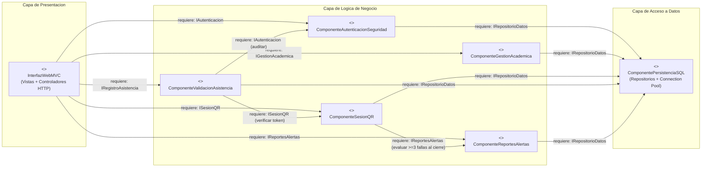

# A5 · Vista de Componentes del Software

**Proyecto:** Sistema de Control de Asistencia Académica con QR Dinámico (`asistencia-qr`)  
**Autor (GitHub):** `@estiben08` · **Ficha:** 3413974  
**RAP asociado:** 593103 (01) · Crea la vista de componentes para visualizar el software en fases avanzadas del ciclo de vida (Criterio 5).

---

## 1. Archivos de la Vista de Componentes

- **Fuente editable Draw.io:** [`A5-vista-componentes.drawio`](./A5-vista-componentes.drawio)
- **Imagen vectorial SVG:** [`A5-vista-componentes.svg`](./A5-vista-componentes.svg)
- **Imagen PNG:** [`A5-vista-componentes.png`](./A5-vista-componentes.png)

---

## 2. Diagrama de Componentes en Mermaid (con Interfaces Provistas y Requeridas)

---

## 3. Tabla de Mapeo de los 7 Componentes (Interfaces Provistas, Requeridas, Clases Agrupadas y Requisitos)

Se diseñan **7 componentes modulares** (superando el mínimo exigible de 5), cada uno con sus interfaces provistas, interfaces requeridas, dirección de dependencia correcta, clases del diagrama `A2` que agrupa y requisitos (`RF` y `RNF`) que atiende:

| # | Componente | Interfaz que Provee | Interfaz que Requiere | Clases del Diagrama `A2` que Agrupa | Requisitos que Atiende |
|---|---|---|---|---|---|
| **1** | **`InterfazWebMVC`** *(Presentación)* | `IControladorHTTP` (Endpoints web y REST/JSON hacia navegadores) | `IAutenticacion`, `IGestionAcademica`, `ISesionQR`, `IRegistroAsistencia`, `IReportesAlertas` | Controladores HTTP (`AuthController`, `CatalogoController`, `SesionQRController`, `AsistenciaController`, `ReporteController`) y plantillas responsivas. | `RF-01`, `RF-04`, `RF-07`, `RF-11`, `RF-12`, `RNF-03` |
| **2** | **`ComponenteAutenticacionSeguridad`** | `IAutenticacion` (`autenticarUsuario`, `verificarPermisoRol`, `registrarEventoAuditoria`) | `IRepositorioDatos` | `Usuario`, `Administrador`, `Instructor`, `Aprendiz`, `GestorHashPassword`, `ServicioAuditoria`. | `RF-01`, `RF-09` (auditoría de rechazos), `RNF-02` |
| **3** | **`ComponenteGestionAcademica`** | `IGestionAcademica` (`gestionarUsuarios`, `gestionarFichas`, `gestionarAmbientes`, `matricularAprendicesMasivo`) | `IAutenticacion`, `IRepositorioDatos` | `FichaFormacion`, `MatriculaFicha`, `AmbienteFormacion`, `ServicioCatalogoAcademico`. | `RF-02`, `RF-03` |
| **4** | **`ComponenteSesionQR`** | `ISesionQR` (`aperturarSesion`, `generarYRotarTokenQR`, `verificarEstadoSesion`, `cerrarSesion`) | `IGestionAcademica`, `IReportesAlertas`, `IRepositorioDatos` | `SesionAsistencia`, `TokenQRSesion`, `GeneradorQRHMAC`. | `RF-04`, `RF-05`, `RF-06`, `RF-11`, `RNF-02` |
| **5** | **`ComponenteValidacionAsistencia`** | `IRegistroAsistencia` (`procesarEscaneoQR`, `registrarContingenciaManual`, `consultarAsistenciaEnVivo`) | `ISesionQR`, `IAutenticacion`, `IRepositorioDatos` | `ServicioControlAsistencia`, `RegistroAsistencia`, `IReglaValidacionAsistencia`, `ValidadorFirmaHMAC`, `ValidadorSubredIP`, `ValidadorUnicidadSesion`. | `RF-07`, `RF-08`, `RF-09`, `RF-10`, `RF-11`, `RNF-01`, `RNF-05` |
| **6** | **`ComponenteReportesAlertas`** | `IReportesAlertas` (`evaluarAlertasDesercion`, `consultarHistorial`, `exportarConsolidado`) | `IRepositorioDatos` | `AlertaInasistencia`, `FabricaExportadorReporte`, `IExportadorReporte`, `ExportadorCSV`, `ExportadorExcel`. | `RF-12`, `RF-13`, `RNF-05` |
| **7** | **`ComponentePersistenciaSQL`** | `IRepositorioDatos` (`ejecutarConsulta`, `ejecutarTransaccion`, `obtenerConexionPool`) | Driver `MySQL TCP/3306` | `MySQLConnectionPool`, `RepositorioUsuario`, `RepositorioFicha`, `RepositorioSesion`, `RepositorioAsistencia`, `RepositorioAuditoria`. | Todos (`RF-01` a `RF-13`), `RNF-01`, `RNF-04` |
