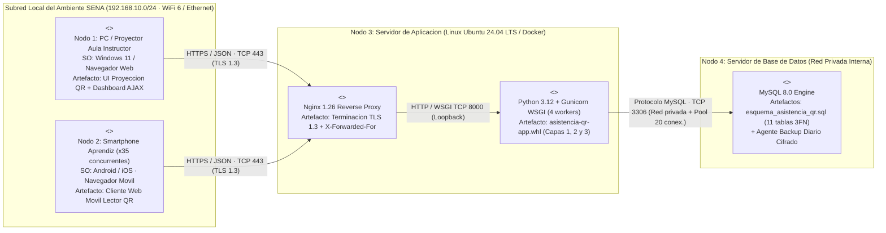

# A6 · Vista de Despliegue del Software

**Proyecto:** Sistema de Control de Asistencia Académica con QR Dinámico (`asistencia-qr`)  
**Autor (GitHub):** `@estiben08` · **Ficha:** 3413974  
**RAP asociado:** 593103 (01) · Crea la vista de despliegue del software para determinar condiciones de la implantación de la solución informática (Criterio 6).

---

## 1. Archivos de la Vista de Despliegue

- **Fuente editable Draw.io:** [`A6-vista-despliegue.drawio`](./A6-vista-despliegue.drawio)
- **Imagen vectorial SVG:** [`A6-vista-despliegue.svg`](./A6-vista-despliegue.svg)
- **Imagen PNG:** [`A6-vista-despliegue.png`](./A6-vista-despliegue.png)

---

## 2. Diagrama de Despliegue en Mermaid

---

## 3. Especificación de Nodos, Artefactos Alojados, Protocolos/Puertos y Decisiones frente a RNF

Se definen **4 nodos físicos/virtuales de despliegue** (superando el mínimo exigible de 3 nodos), especificando para cada uno los artefactos que aloja, el protocolo y puerto exacto de cada conexión, y la decisión técnica que responde a los Requisitos No Funcionales:

| # | Nodo de Despliegue | Artefactos que Aloja | Conexión (Protocolo y Puerto) | Decisión de Despliegue que Responde a un RNF |
|---|---|---|---|---|
| **1** | **`Nodo 1: Cliente Aula (PC del Instructor + Pantalla/Proyector)`** | - Navegador Web Estándar (Chrome/Edge). - Artefacto cliente: `ui-proyeccion-qr.js` + `dashboard-monitoreo.html` (rotación asíncrona de QR cada 30 s y refresco de lista cada 10 s). | **`HTTPS sobre TCP/443 (TLS 1.3)`** hacia el Nodo 3 (`Servidor de Aplicación`), dentro de la subred del ambiente (`192.168.10.0/24`). | **Responde a `RNF-02` (Seguridad) y `RF-04`/`RF-08`:** Al conectarse desde la subred del aula, registra la IP de referencia del ambiente; el canal `TLS 1.3` impide que el token QR en tránsito sea interceptado por *sniffing* en la red local. |
| **2** | **`Nodo 2: Cliente Móvil (Smartphone del Aprendiz en Red WiFi del Aula)`** | - Navegador Móvil Estándar (Chrome Android / Safari iOS). - Artefacto cliente: `ui-escaneo-movil.html` + `scanner-qr.js` (*Mobile-First*, `< 50 KB`). | **`HTTPS sobre TCP/443 (TLS 1.3)`** hacia el Nodo 3 (`Servidor de Aplicación`), saliendo por el Punto de Acceso WiFi de la misma subred del aula (`192.168.10.0/24`). | **Responde a `RNF-03` (Usabilidad Móvil) y `RNF-02` (Seguridad):** No requiere instalar APK ni app nativa; el uso obligatorio de `HTTPS/443` habilita el permiso seguro de cámara en navegadores móviles modernos (`getUserMedia`) y preserva la IP de subred local para validación antifraude. |
| **3** | **`Nodo 3: Servidor de Aplicación (Host Linux Ubuntu 24.04 LTS / Contenedor App)`** | - **Proxy Inverso Nginx 1.26:** certificado TLS, compresión gzip y propagación de cabecera `X-Real-IP`. - **Entorno Gunicorn WSGI + Python 3.12 (4 workers):** paquete `asistencia-qr-app` con los componentes `InterfazWebMVC`, `ComponenteAutenticacionSeguridad`, `ComponenteGestionAcademica`, `ComponenteSesionQR`, `ComponenteValidacionAsistencia`, `ComponenteReportesAlertas` y `ComponentePersistenciaSQL`. | - Entrada externa: **`HTTPS TCP/443 (TLS 1.3)`** desde Nodos 1 y 2. - Comunicación interna proxy → app: **`HTTP/WSGI TCP/8000 (loopback 127.0.0.1)`**. - Salida hacia datos: **`Protocolo MySQL TCP/3306`** hacia el Nodo 4. | **Responde a `RNF-01` (Desempeño `<= 1,5 s` con 35 concurrentes) y `RNF-04` (Disponibilidad `99,5 %`):** Los 4 *workers* pre-cargados de Gunicorn junto al `MySQLConnectionPool` de 20 conexiones procesan las ráfagas de 35 escaneos simultáneos en `< 150 ms` sin bloqueo de I/O, con reinicio automático (`restart: always`) ante caídas. |
| **4** | **`Nodo 4: Servidor de Base de Datos (Motor Relacional en Subred Privada)`** | - **Motor MySQL 8.0.** - Artefacto de esquema: `B5-script-creacion.sql` (`esquema_asistencia_qr`, 11 tablas normalizadas en 3FN, índices y restricciones). - Artefacto operativo: `backup-diario-cifrado.sh` (volcado automatizado `mysqldump` cifrado con AES-256). | **`Protocolo MySQL sobre TCP/3306`** aceptando conexiones **únicamente** desde la IP interna del Nodo 3 (subred privada de backend, sin puerto expuesto a Internet ni a la red WiFi de aprendices). | **Responde a `RNF-02` (Confidencialidad/Integridad) y `RNF-04` (Disponibilidad y Respaldo):** El aislamiento del puerto `3306` en red privada impide cualquier conexión directa desde dispositivos de aprendices a la base de datos; el agente de respaldo diario garantiza `RPO <= 24 h` y `RTO <= 2 h`. |
