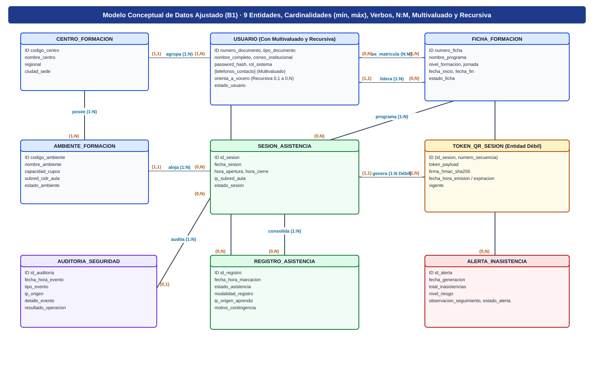

# B1 · Modelo Conceptual de Datos Ajustado a Base de Datos Relacional

**Proyecto:** Sistema de Control de Asistencia Académica con QR Dinámico (`asistencia-qr`)  
**Autor (GitHub):** `@estiben08` · **Ficha:** 3413974  
**RAP asociado:** 593101 (02) · Genera el modelo conceptual de acuerdo con el tipo de base de datos seleccionada y las especificaciones del análisis (Criterio 1).

---

## 1. Archivos del Modelo Conceptual

- **Fuente editable Draw.io:** [`B1-modelo-conceptual.drawio`](./B1-modelo-conceptual.drawio)
- **Imagen vectorial SVG:** [`B1-modelo-conceptual.svg`](./B1-modelo-conceptual.svg)
- **Imagen PNG:** [`B1-modelo-conceptual.png`](./B1-modelo-conceptual.png)

---

## 2. Ajuste respecto al Análisis (Guía 1) y Justificación del Tipo de Base de Datos

De acuerdo con la sección 1.1 de `Rubricas_G2.md`, el modelo conceptual elaborado en la Guía 1 se reutiliza y ajusta aquí a las especificaciones del diseño relacional:
1. **Incorporación de las entidades de configuración institucional y auditoría (`CENTRO_FORMACION` y `AUDITORIA_SEGURIDAD`):** En la fase de diseño se separó `CENTRO_FORMACION` (que en `SRC.docx` aparecía como un atributo de texto `centro` repetido en cada usuario) para eliminar redundancia transitiva (3FN), y se formalizó `AUDITORIA_SEGURIDAD` para soportar la trazabilidad inmutable de rechazos de IP/HMAC (`RF-08`, `RF-09`) y ajustes manuales (`RF-10`).
2. **Identificación explícita de atributo multivaluado (`telefonos_contacto` en `USUARIO`):** Se marca explícitamente como atributo multivaluado en el modelo conceptual para su transformación formal a la tabla `telefono_usuario` en el modelo lógico (`B2`).
3. **Justificación del motor relacional (MySQL 8.0 / SQL ANSI):** El dominio exige atomicidad y consistencia inmediata al validar 35 escaneos QR simultáneos en una ventana de 30 segundos, integridad referencial estricta entre sesiones, tokens QR y asistencias, y unicidad compuesta `(sesion, aprendiz)` garantizada por el motor.

---

## 3. Catálogo de Entidades Conceptuales, Cardinalidades `(mín, máx)`, Verbos y Trazabilidad

Se modelan **9 entidades conceptuales** (superando el mínimo exigible de 6), con notación consistente **Pata de Gallo (*Crow's Foot*) + `(mín, máx)`**:

| # | Entidad Conceptual | Identificador Conceptual | Atributos Principales | Relaciones, Verbos y Cardinalidades `(mín, máx)` | Requisito(s) que Soporta |
|---|---|---|---|---|---|
| 1 | **`CENTRO_FORMACION`** | `codigo_centro` | `nombre_centro`, `regional`, `ciudad_sede` | - `agrupa` → `USUARIO` `(1,1)` a `(1,N)` - `posee` → `AMBIENTE_FORMACION` `(1,1)` a `(1,N)` - `oferta` → `FICHA_FORMACION` `(1,1)` a `(1,N)` | `RF-02` |
| 2 | **`USUARIO`** | `numero_documento` | `tipo_documento`, `nombre_completo`, `correo_institucional`, `password_hash`, `rol_sistema`, `{telefonos_contacto}` *(multivaluado)*, `estado_usuario` | - **`orienta_a` (Recursiva):** `Vocero (0,1)` ↔ `(0,N) Aprendiz` - **`se_matricula_en` (`N:M`):** `USUARIO (0,N)` ↔ `(1,N) FICHA_FORMACION` - `lidera` → `FICHA_FORMACION` `(1,1)` a `(0,N)` | `RF-01`, `RF-02`, `RF-03`, `RNF-02` |
| 3 | **`AMBIENTE_FORMACION`** | `codigo_ambiente` | `nombre_ambiente`, `capacidad_cupos`, `subred_cidr_aula`, `estado_ambiente` | - `aloja` → `SESION_ASISTENCIA` `(1,1)` a `(0,N)` | `RF-02`, `RF-04`, `RF-08` |
| 4 | **`FICHA_FORMACION`** | `numero_ficha` | `nombre_programa`, `nivel_formacion`, `jornada`, `fecha_inicio`, `fecha_fin`, `estado_ficha` | - **`vincula` (`N:M` con `USUARIO`)** con atributos del vínculo (`fecha_vinculacion`, `estado_matricula`) - `programa` → `SESION_ASISTENCIA` `(1,1)` a `(0,N)` | `RF-02`, `RF-03`, `RF-04`, `RF-12` |
| 5 | **`SESION_ASISTENCIA`** | `id_sesion` | `fecha_sesion`, `hora_apertura`, `hora_cierre`, `ip_subred_aula`, `estado_sesion` | - `genera` → `TOKEN_QR_SESION` *(Entidad Débil)* `(1,1)` a `(1,N)` - `consolida` → `REGISTRO_ASISTENCIA` `(1,1)` a `(0,N)` | `RF-04`, `RF-06`, `RF-11` |
| 6 | **`TOKEN_QR_SESION`** *(Entidad Débil)* | `(id_sesion, numero_secuencia)` | `token_payload`, `firma_hmac_sha256`, `fecha_hora_emision`, `fecha_hora_expiracion`, `vigente` | - `depende_de` → `SESION_ASISTENCIA` `(1,1)` a `(1,N)` | `RF-05`, `RF-06`, `RF-08`, `RNF-02` |
| 7 | **`REGISTRO_ASISTENCIA`** | `id_registro` | `fecha_hora_marcacion`, `estado_asistencia`, `modalidad_registro`, `ip_origen_aprendiz`, `motivo_contingencia` | - `pertenece_a` `SESION_ASISTENCIA` `(1,1)` - `corresponde_a` `USUARIO` `(1,1)` | `RF-07`, `RF-08`, `RF-09`, `RF-10`, `RF-11`, `RF-12` |
| 8 | **`ALERTA_INASISTENCIA`** | `id_alerta` | `fecha_generacion`, `total_inasistencias`, `nivel_riesgo`, `observacion_seguimiento`, `estado_alerta` | - `alerta_sobre` `USUARIO` `(1,1)` a `(0,N)` - `en_ficha` `FICHA_FORMACION` `(1,1)` a `(0,N)` | `RF-13` |
| 9 | **`AUDITORIA_SEGURIDAD`** | `id_auditoria` | `fecha_hora_evento`, `tipo_evento`, `ip_origen`, `detalle_evento`, `resultado_operacion` | - `registra_actor` `USUARIO` `(0,1)` a `(0,N)` - `en_sesion` `SESION_ASISTENCIA` `(0,1)` a `(0,N)` | `RF-08`, `RF-09`, `RF-10`, `RNF-02` |
