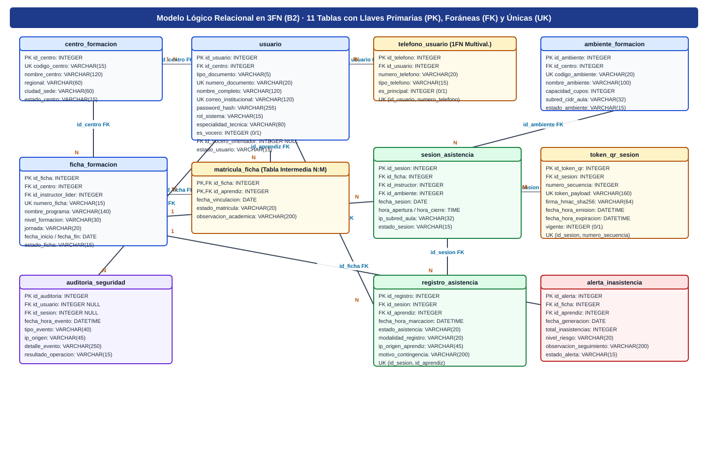

# B2 · Modelo Lógico Relacional y Cuadro de Reglas de Transformación

**Proyecto:** Sistema de Control de Asistencia Académica con QR Dinámico (`asistencia-qr`)  
**Autor (GitHub):** `@estiben08` · **Ficha:** 3413974  
**RAP asociado:** 593101 (02) · Genera el modelo lógico de acuerdo con la técnica seleccionada (Criterio 2).

---

## 1. Archivos del Modelo Lógico Relacional

- **Fuente editable Draw.io:** [`B2-modelo-logico.drawio`](./B2-modelo-logico.drawio)
- **Imagen vectorial SVG:** [`B2-modelo-logico.svg`](./B2-modelo-logico.svg)
- **Imagen PNG:** [`B2-modelo-logico.png`](./B2-modelo-logico.png)

---

## 2. Cuadro de Reglas de Transformación Aplicadas (Conceptual → Lógico Relacional)

Siguiendo el formato de la sección 7 de `Plantillas_G2.md`, se documentan todas las reglas de transformación aplicadas para pasar de las 9 entidades conceptuales (`B1`) a las **11 tablas relacionales en 3FN**:

| # | Regla de Transformación Relacional | Caso en el Dominio `asistencia-qr` | Resultado Exacto en el Modelo Lógico Relacional |
|---|---|---|---|
| **1** | **Relación `N:M` se resuelve con tabla intermedia (asociativa)** | Un aprendiz (`usuario`) puede cursar una o varias fichas a lo largo de su formación y una `ficha_formacion` tiene múltiples aprendices matriculados. | Se crea la tabla intermedia **`matricula_ficha`** con **llave primaria compuesta `PRIMARY KEY (id_ficha, id_aprendiz)`**, llaves foráneas `id_ficha -> ficha_formacion(id_ficha)` e `id_aprendiz -> usuario(id_usuario)`, y atributos propios (`fecha_vinculacion`, `estado_matricula`, `observacion_academica`). |
| **2** | **Relación `1:N`: la llave foránea (`FK`) se ubica en el lado «muchos» (`N`)** | - Un centro tiene muchos usuarios, ambientes y fichas. - Un instructor lidera muchas fichas y abre muchas sesiones. - Una ficha y un ambiente alojan muchas sesiones. - Una sesión consolida muchos registros de asistencia. | - `usuario.id_centro FK`, `ambiente_formacion.id_centro FK`, `ficha_formacion.id_centro FK`. - `ficha_formacion.id_instructor_lider FK`. - `sesion_asistencia.id_ficha FK`, `id_instructor FK`, `id_ambiente FK`. - `registro_asistencia.id_sesion FK`, `id_aprendiz FK` (con `UNIQUE (id_sesion, id_aprendiz)`). |
| **3** | **Entidad débil (`1:N` identificadora) pasa a tabla con `FK` hacia la entidad fuerte y clave única compuesta** | `TOKEN_QR_SESION` depende en existencia e identificación de `SESION_ASISTENCIA` (cada 30 s se emite una nueva secuencia). | Tabla **`token_qr_sesion`** con `id_token_qr PK`, `id_sesion FK NOT NULL ON DELETE CASCADE` hacia `sesion_asistencia(id_sesion)` y restricción de clave candidata compuesta **`UNIQUE (id_sesion, numero_secuencia)`**. |
| **4** | **Atributo multivaluado se transforma en una tabla aparte (`1:N`)** | Un `usuario` (instructor o aprendiz) puede registrar uno o varios números telefónicos de contacto (`{telefonos_contacto}`). | El atributo sale de la tabla `usuario` (cumpliendo 1FN) y se crea la tabla **`telefono_usuario(id_telefono PK, id_usuario FK, numero_telefono, tipo_telefono, es_principal)`** con `UNIQUE (id_usuario, numero_telefono)`. |
| **5** | **Relación recursiva unaria (`1:N`) se transforma en auto-referencia (`FK` hacia la misma tabla)** | Un aprendiz con condición de vocero orienta a otros aprendices de la ficha (`orienta_como_vocero`, cardinalidad `0..1` a `0..N`). | Columna **`usuario.id_vocero_orientador INTEGER NULL`** como llave foránea recursiva `FOREIGN KEY (id_vocero_orientador) REFERENCES usuario(id_usuario) ON DELETE SET NULL`. |
| **6** | **Generalización / Herencia (`Usuario` → `Administrador`, `Instructor`, `Aprendiz`)** | Los tres roles comparten el 90 % de los atributos de identidad y autenticación (`numero_documento`, `nombre_completo`, `correo_institucional`, `password_hash`) y una misma persona puede actuar en sesiones del sistema. | **Tabla única por jerarquía (`Single Table Inheritance`) en `usuario`** con columna discriminadora `rol_sistema CHECK (rol_sistema IN ('ADMIN', 'INSTRUCTOR', 'APRENDIZ'))` y atributos específicos (`especialidad_tecnica`, `es_vocero`), justificada para evitar `JOIN`s innecesarios en cada login (`RF-01`, `RNF-01`) y garantizar unicidad global de `numero_documento` y `correo_institucional`. |

---

## 3. Esquema Relacional de las 11 Tablas del Modelo Lógico (con PK, FK y UK)

1. **`centro_formacion`** (`id_centro` **PK**, `codigo_centro` **UK**, `nombre_centro`, `regional`, `ciudad_sede`, `estado_centro`)
2. **`usuario`** (`id_usuario` **PK**, `id_centro` **FK**, `tipo_documento`, `numero_documento` **UK**, `nombre_completo`, `correo_institucional` **UK**, `password_hash`, `rol_sistema`, `especialidad_tecnica`, `es_vocero`, `id_vocero_orientador` **FK recursiva**, `estado_usuario`)
3. **`telefono_usuario`** (`id_telefono` **PK**, `id_usuario` **FK**, `numero_telefono`, `tipo_telefono`, `es_principal` · **UK** `(id_usuario, numero_telefono)`)
4. **`ambiente_formacion`** (`id_ambiente` **PK**, `id_centro` **FK**, `codigo_ambiente` **UK**, `nombre_ambiente`, `capacidad_cupos`, `subred_cidr_aula`, `estado_ambiente`)
5. **`ficha_formacion`** (`id_ficha` **PK**, `id_centro` **FK**, `id_instructor_lider` **FK**, `numero_ficha` **UK**, `nombre_programa`, `nivel_formacion`, `jornada`, `fecha_inicio`, `fecha_fin`, `estado_ficha`)
6. **`matricula_ficha`** (`id_ficha` **PK, FK**, `id_aprendiz` **PK, FK**, `fecha_vinculacion`, `estado_matricula`, `observacion_academica`)
7. **`sesion_asistencia`** (`id_sesion` **PK**, `id_ficha` **FK**, `id_instructor` **FK**, `id_ambiente` **FK**, `fecha_sesion`, `hora_apertura`, `hora_cierre`, `ip_subred_aula`, `estado_sesion`)
8. **`token_qr_sesion`** (`id_token_qr` **PK**, `id_sesion` **FK**, `numero_secuencia`, `token_payload` **UK**, `firma_hmac_sha256`, `fecha_hora_emision`, `fecha_hora_expiracion`, `vigente` · **UK** `(id_sesion, numero_secuencia)`)
9. **`registro_asistencia`** (`id_registro` **PK**, `id_sesion` **FK**, `id_aprendiz` **FK**, `fecha_hora_marcacion`, `estado_asistencia`, `modalidad_registro`, `ip_origen_aprendiz`, `motivo_contingencia` · **UK** `(id_sesion, id_aprendiz)`)
10. **`alerta_inasistencia`** (`id_alerta` **PK**, `id_ficha` **FK**, `id_aprendiz` **FK**, `fecha_generacion`, `total_inasistencias`, `nivel_riesgo`, `observacion_seguimiento`, `estado_alerta`)
11. **`auditoria_seguridad`** (`id_auditoria` **PK**, `id_usuario` **FK**, `id_sesion` **FK**, `fecha_hora_evento`, `tipo_evento`, `ip_origen`, `detalle_evento`, `resultado_operacion`)
